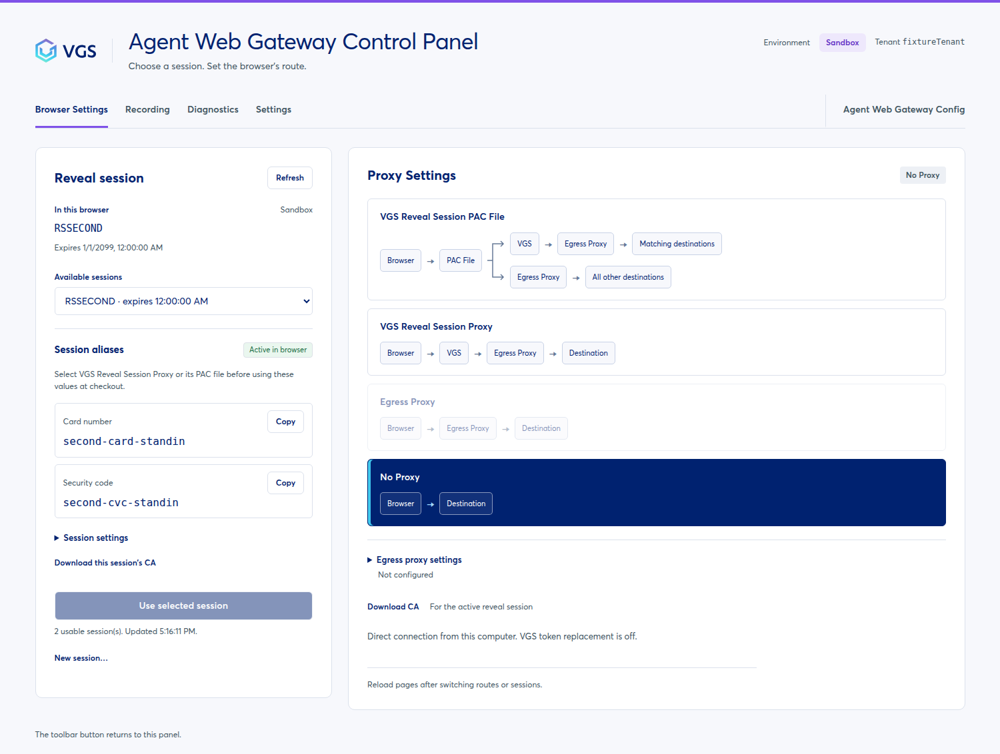
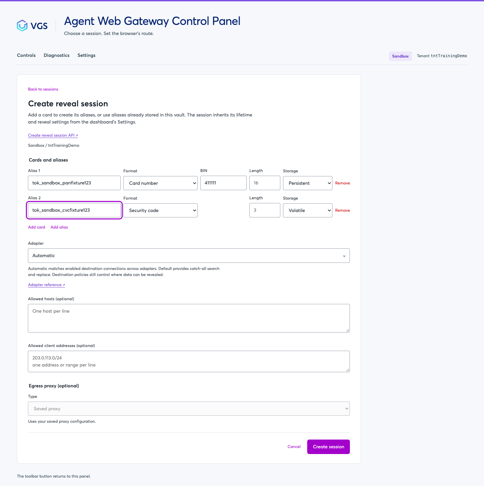
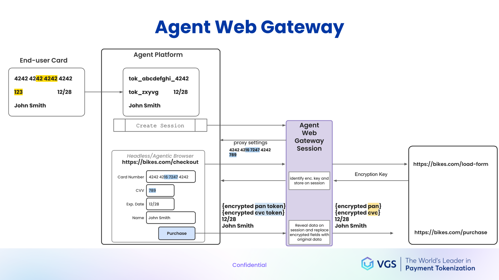
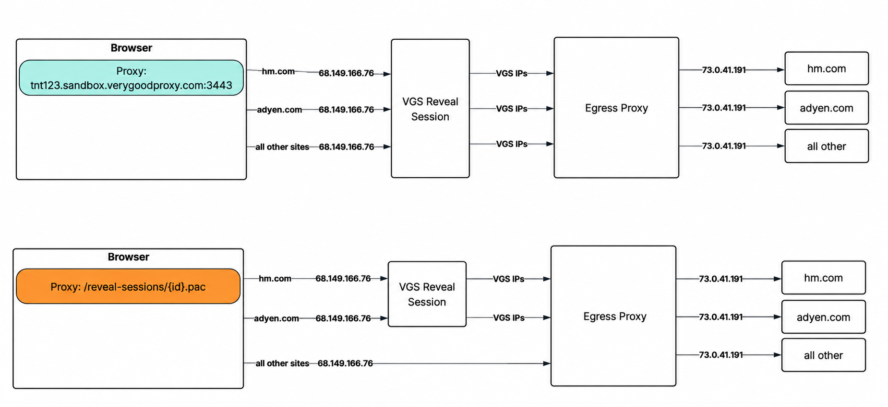

<p align="center"><a href="https://www.verygoodsecurity.com"><picture>
  <source media="(prefers-color-scheme: dark)" srcset="docs/images/vgs-logo-dark.svg">
  
</picture></a></p>

# Agent Web Gateway Dev Kit

[Quickstart](#quickstart) · [Browsers](examples/README.md#browsers) · [Adapters](examples/README.md#provider-adapters) · [Control Panel](docs/control-panel.md) · [Terminology](#terminology) · [All docs](docs/README.md)

[](tools/vgs-proxy-controls/screenshots/control-panel.png)

## Quickstart

Your organization needs a Sandbox tenant with Agent Web Gateway enabled.

```sh
git clone https://github.com/vgs-samples/agent-web-gateway-dev-kit.git
cd agent-web-gateway-dev-kit
./awg setup    # log in to VGS and create Sandbox credentials, once
./awg start    # a test-card session and a browser with the Control Panel
```

Enter the session aliases from the Control Panel into the website's fields, and check the captured requests as you test. Use public test cards while working in Sandbox.

## Works with

| | Where the browser runs | Command |
|---|---|---|
|  | CloakBrowser on your machine | `./awg start` |
|  | [Browser Use](docs/browser-use.md) on your machine | `./awg browser-use` |
|  | [Browser Use Cloud](docs/browser-use.md#use-a-browser-use-cloud-browser) | `./awg browser-use --cloud` |
|  | [Kernel](docs/kernel.md) | `./awg kernel` |
|  | [Browserbase](docs/browserbase.md) | `./awg browserbase` |

Providers that encrypt the card fields in the browser need an adapter. The [examples](examples/README.md#provider-adapters) have adapters for Adyen, CyberSource, Stripe and OPPWA, each with its functions, bindings, tests and synthetic fixtures.

## What is the VGS Agent Web Gateway?

The [VGS Agent Web Gateway](https://docs.verygoodsecurity.com/agentic-commerce/developer-resources/api-reference/agent-web-gateway) lets an AI agent use sensitive data on a website without giving that data to the agent or its browser. Cards, email addresses, passwords, Social Security numbers - the agent works with short-lived, tightly scoped tokens called **session aliases**. VGS replaces them with the real values inside the gateway, before the request reaches an approved destination.

Your application stores sensitive data with VGS and keeps its vault aliases. When the agent needs to browse, your application creates a reveal session with the data and destinations it needs. The session returns values the agent can enter into forms, plus the proxy settings for its browser. The session aliases stop working when that session ends.

Agent Web Gateway includes:

- **TLS emulation.** Browser-compatible outbound TLS behavior for traffic passing through VGS. See [browser proxying](docs/browser-proxying.md).
- **Customer-controlled client-side encryption support.** Write adapters and VGS Compute functions for a provider's encryption or payload format. You control the code and where it runs.
- **Egress proxies.** Use your own outbound proxy for VGS traffic and, with PAC routing, the browser's other traffic.
- **IP allow-listing.** Restrict which client IPs can use a session with `allowed_client_cidrs`.
- **Intelligent proxy routing through generated PAC files.** Send the hosts that need VGS through the gateway and route other traffic through your egress proxy or directly.
- **Granular reveal controls.** Combine session aliases, destination policies, guarded reveal limits, and short session lifetimes to control when and where sensitive data is released.

### Visualization

[](docs/images/awg-flow-token-swap.png)

1. **Protect the end-user's card.** Collect and tokenize the sensitive card fields through VGS.
2. **Keep vault aliases in the agent platform.** The platform holds aliases for the PAN and CVC.
3. **Create a reveal session.** Send the aliases and permitted destination hosts to VGS.
4. **Receive proxy settings and session aliases.** VGS returns connection details and card-shaped values scoped to the session.
5. **Fill the website's form.** The agent enters the session aliases.
6. **Route the request through VGS.** The browser sends the request through the session proxy.
7. **Transform the request inside VGS.** The gateway checks policy, reveals permitted values, and runs matching adapter functions.
8. **Deliver the values to the destination.** The merchant or payment provider receives the data it needs. The agent continues to work with session aliases.

The [official OpenAPI spec](https://openapi.gitbook.com/o/hcowjO8ckQ1K5fm3NPZH/spec/agent-web-gateway-api.yaml) is maintained in the VGS documentation.

## How to use this Dev Kit

The kit comes with:

- **An [Agent Web Gateway Control Panel Chromium extension](docs/control-panel.md)** for testing, debugging, and building adapters for new vendors and sites. [Download the latest build artifact](https://github.com/vgs-samples/agent-web-gateway-dev-kit/actions/workflows/control-panel-package.yml) from its newest successful run, or use the [download and build guide](docs/training/extension-distribution.md) to find the latest successful build. GitHub artifacts require sign-in and expire after 30 days.
- **An [MCP companion](docs/mcp.md)** so your assistant can capture browser traffic, inspect HARs, and work with functions, adapters, destinations, and bindings. Writes must be enabled before it can modify those resources.
- **[Adapter-authoring skills](skills/vgs-checkout-adapter/SKILL.md)** for reading HAR evidence, creating synthetic fixtures, writing VGS Compute functions, testing locally in Starlarky, and registering and verifying an adapter. Start with the [provider examples](examples/adapters/README.md).
- **Cloud and agent browser options** for [Browser Use](docs/browser-use.md), [Kernel](docs/kernel.md) and [Browserbase](docs/browserbase.md), each started with one command.
- **Browser setup instructions** for [CloakBrowser](#agent-web-gateway-control-panel-chromium-extension), [Chrome for Testing, Chromium, Chrome, Edge, and Brave](docs/training/10-proxy-controls-extension.md#browser-launch-examples). Browser installation and extension loading differ; the guide covers each. Follow [Browser proxying best practices](docs/browser-proxying.md) for egress, PAC routing, and when to create the payment session.

To set it up with a coding assistant, open the cloned repo in it, give it access to the directory and paste:

> Read AGENTS.md and set up this dev kit. Use the checkout adapter skill when we work on a provider integration. Read the README and setup guide first, run the offline checks, and help me connect my Sandbox organization. Keep credentials and private captures out of chat and source control.

The assistant needs file and terminal access. You can also run account setup yourself:

```sh
./awg setup
```

Setup installs [VGS CLI](https://docs.verygoodsecurity.com/vault/developer-tools/vgs-cli/getting-started) with `uv`, runs `vgs login`, and asks which organization to use. It selects a Sandbox tenant, creates the service account, saves the credentials locally, and checks access. Your organization needs a Sandbox tenant with Agent Web Gateway enabled. See the [setup guide](docs/setup.md) for dependencies and recovery.

<details>
<summary><strong>If the service account is missing scopes</strong></summary>

`./awg setup` and `./awg start` print `Note: … lacks: …` with the exact scope names when the account is missing any. The kit carries on with the scopes the account has. Scopes cannot be added to an existing service account, so to get one with every scope the kit uses, run:

```sh
./awg setup --force
```

You can do this yourself if your VGS login is allowed to create service accounts in the organization; otherwise ask your organization's administrator. If the new account is still missing scopes, your organization has not been granted them, and only VGS can enable them. See [missing scopes](docs/setup.md#missing-scopes).

</details>

<details>
<summary><strong>If your vault has no Cards API</strong></summary>

Nothing else is needed. The kit tries the Cards API, and when it is refused it stores the test card through the vault alias API and creates the session from those aliases. To point the kit at a particular Sandbox vault and skip the Cards API outright (the IDs are placeholders):

```sh
./awg setup --organization AC_YOUR_ORGANIZATION --tenant tntYOURVAULT
AWG_CARD_STORE=aliases ./awg start
```

The vault needs Agent Web Gateway enabled by VGS, and the service account needs `aliases:write`, `reveal-sessions:read`, `reveal-sessions:write`, `agent-gateway:read` and `agent-gateway:write`. The Sandbox hosts follow from the vault ID, so there is no host to configure. See the [setup guide](docs/setup.md#automatic-service-account-creation).

</details>

## Agent Web Gateway Control Panel Chromium Extension

The [Control Panel](docs/control-panel.md) gives you a place to create and select reveal sessions, inspect session aliases, choose a browser route, record traffic, and inspect gateway configuration. Use it to work through a checkout, diagnose a failing transformation, or collect the evidence for a new adapter.

[](tools/vgs-proxy-controls/screenshots/control-panel.png)

### Start the browser

Run this in your own terminal from the repo:

```sh
./awg start
# Or open a test website in a second tab:
./awg start https://the-shop-you-are-testing.com/
```

This creates or reuses an active test-card session and opens CloakBrowser with the Control Panel. The kit installs its Python and browser packages through `uv` as needed. CloakBrowser needs a license key; save it locally with `./awg cloak-login` when prompted. If macOS blocks the first launch, allow it in **System Settings → Privacy & Security**.

If your coding assistant's sandbox blocks the browser or local helper, run the command yourself rather than retrying it inside the sandbox. In Claude Code, you can use `! ./awg start`. For other browsers, follow the [browser launch examples](docs/training/10-proxy-controls-extension.md#browser-launch-examples).

### Use another browser

Browser Use, Browser Use Cloud, Kernel and Browserbase each start with one command instead of `./awg start`. The commands, what each one needs, and agents and a vendor payment flow to start from are in the [examples](examples/README.md#browsers). The cloud commands ask for the provider's API key on the first run and save it privately on your machine, so later runs need nothing.

### Create sessions for cards

1. Open **New session…** and add a card through VGS Collect, or use the available vault aliases. Use public test cards while working in Sandbox.
2. Include the card number and CVC aliases, the permitted hosts, and the egress proxy for the checkout. Select a provider adapter when the integration needs one.
3. Create the session and select it in the panel. Enter its **session aliases** into the website's fields.
4. Choose the session's PAC route or route all traffic through VGS. Check the session status, reveal counts, and captured requests as you test.

[](tools/vgs-proxy-controls/screenshots/create-session.png)

Create a fresh session near checkout so it lasts through the test. Keep HARs private: they can contain cookies, credentials, and customer data. Submitting an order or payment requires separate authorization. The [Control Panel guide](docs/control-panel.md) covers the workflow; the [Reveal Sessions API](https://docs.verygoodsecurity.com/agentic-commerce/developer-resources/api-reference/agent-web-gateway/reveal-sessions) covers programmatic use.

## Terminology

### 1. Destinations

**[Destinations](https://docs.verygoodsecurity.com/agentic-commerce/developer-resources/api-reference/agent-web-gateway/destinations)** are places on the internet that your tenant knows how to operate with. A destination identifies a host or host pattern and how VGS should treat it: trusted, guarded, or blocked. Session settings and destination policy determine whether VGS may reveal data there.

An **[adapter destination](https://docs.verygoodsecurity.com/agentic-commerce/developer-resources/api-reference/agent-web-gateway/adapter-destinations)**, also called a binding, connects an adapter's functions to a host, path, method, and request or response phase.

### 2. Adapters

An **[adapter](https://docs.verygoodsecurity.com/agentic-commerce/developer-resources/api-reference/agent-web-gateway/adapters)** groups the VGS Compute functions needed for a website's encryption or payload format. For example, one function can capture a provider's public key from a response and save it in the session. A second function can use that key to encrypt the real data when the browser sends its payment request.

[](docs/images/awg-flow-client-side-encryption.png)

Name reusable adapters for the provider and put merchant routing in the bindings. The [examples](examples/README.md#provider-adapters) have adapters for Adyen, CyberSource, Stripe and OPPWA, each with its functions, bindings, tests and synthetic fixtures.

#### The Default adapter

The **Default adapter** is the built-in search-and-replace path. When it handles a permitted request, it finds the session aliases in supported request fields and replaces them with their underlying values. That lets you try a new site without first writing a provider-specific adapter, when the site submits those aliases intact.

Default processing still follows session and destination policy. It cannot find aliases hidden inside application-encrypted ciphertext; that is where a custom adapter is needed. Custom bindings can take over request processing, so validate their interaction with Default rather than assuming both will run.

#### Guarded destinations

**Guarded destinations** let you evaluate new destinations with limited reveals. Guard limits can permit an initial allowance, then refuse further reveals when the allowance is exhausted. An authorized person or application must review and explicitly trust the destination to permit continued use beyond those limits. You can do that through the destination controls or the [Destinations API](https://docs.verygoodsecurity.com/agentic-commerce/developer-resources/api-reference/agent-web-gateway/destinations).

The allowance comes from the applicable guard policy; it is not an unlimited trial or one universal request count. Successful traffic does not automatically make a destination trusted. A tenant's unlisted-host mode may instead block a new host or require [step-up approval](https://docs.verygoodsecurity.com/agentic-commerce/developer-resources/api-reference/agent-web-gateway/step-up-approvals).

### 3. Functions

A **VGS Compute function** is a script that runs inside VGS to process sensitive data in transit. Within an adapter, bindings attach functions to specific destinations and requests or responses. Functions can capture provider keys, access authorized vault data, transform payloads, and save session values for a later request.

[VGS Compute](https://docs.verygoodsecurity.com/vault/developer-tools/larky) uses the Starlarky runtime and Python-like Larky syntax. See the [Functions API](https://docs.verygoodsecurity.com/agentic-commerce/developer-resources/api-reference/agent-web-gateway/functions) and [local testing instructions](examples/adapters/README.md#run-the-tests).

### 4. Reveal Sessions

**[Reveal sessions](https://docs.verygoodsecurity.com/agentic-commerce/developer-resources/api-reference/agent-web-gateway/reveal-sessions)** are short-lived proxy sessions for a browser or HTTP client. They carry the authorized data, permitted hosts, connection credentials, and session aliases. Their generated PAC file simplifies routing.

Use a defined provider adapter for a custom integration, or the Default search-and-replace behavior where it is sufficient. Session lifetime is configured at the tenant level. End the session when the browsing task is finished; it also expires automatically.

#### Egress proxy

An **egress proxy** is the outbound proxy that connects to the destination. You can supply your own in `egress_proxy_settings`. VGS can use it for gateway traffic, and the PAC route can send other browser traffic through it as well. This keeps both paths on the selected egress route.

**1. Proxy everything through VGS.** Configure the browser with the session proxy. Browser traffic goes through VGS, then through the configured egress proxy to the destination.

**2. Proxy only required hosts through VGS using the session's PAC file.** The generated PAC rules send hosts that need session handling through VGS. Other traffic goes straight to the configured egress proxy, or directly when no egress is configured. PAC routing chooses by host, not by individual URL path; adapter bindings perform the finer matching inside VGS.

[](docs/images/awg-egress-routing.png)

To start a session on a proxy you saved in the Control Panel, put its name in front of any session or browser command: `AWG_EGRESS="My proxy" ./awg start`. A cloud browser stays on the session it started with, so this is how one gets an egress proxy.

See [browser proxying and egress setup](docs/browser-proxying.md) for the routing controls and certificate setup.

### 5. Session Aliases

**Session aliases** are short-lived values representing the sensitive data loaded into a reveal session. They are what the agent sees and enters into a website. A card-number alias keeps a usable card shape; the raw PAN remains in VGS. These values are also called session tokens in the API and some guides.

Session aliases belong to one session and stop working when it ends. They are different from the persistent vault aliases your application stores and uses to create a session. See [the three card values](docs/training/02-concepts.md#three-card-values).

## Client-side Encryption

Some providers encrypt the card fields in the browser before sending them. The browser then encrypts the session aliases, so the Default adapter can no longer replace those values directly. An adapter coordinates VGS Compute functions across the key-capture and payment requests.

The [examples](examples/README.md#client-side-encryption) walk through the Adyen and CyberSource adapters step by step, with local tests for each.
