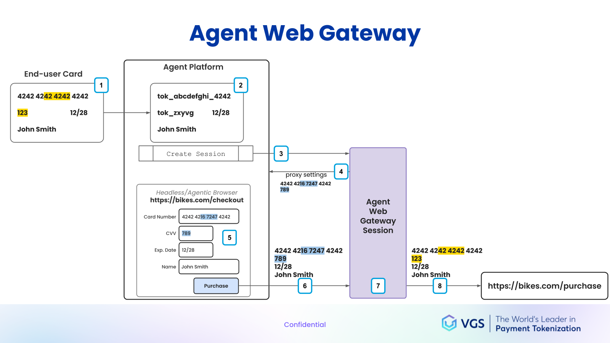
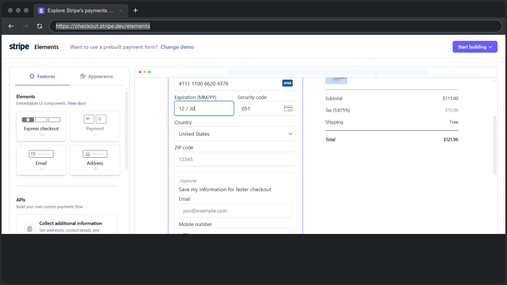

# Agent Web Gateway Dev Kit

## What is the VGS Agent Web Gateway?

The [VGS Agent Web Gateway](https://docs.verygoodsecurity.com/agentic-commerce/developer-resources/api-reference/agent-web-gateway) lets an AI agent use sensitive data on a website without giving that data to the agent or its browser. Cards, email addresses, passwords, Social Security numbers - the agent works with short-lived, tightly scoped tokens called **session aliases**. VGS replaces them with the real values inside the gateway, before the request reaches an approved destination.

Your application stores sensitive data with VGS and keeps its vault aliases. When the agent needs to browse, your application creates a reveal session with the data and destinations it needs. The session returns values the agent can enter into forms, plus the proxy settings for its browser. The session aliases stop working when that session ends.

Agent Web Gateway includes:

- **TLS emulation.** Browser-compatible outbound TLS behavior for traffic passing through VGS. See [browser proxying](docs/browser-proxying.md).
- **Customer-controlled client-side encryption support.** Write adapters and VGS Compute functions for a provider's encryption or payload format. You control the code and where it runs.
- **Egress proxies.** Use your own outbound proxy for VGS traffic and, with PAC routing, the browser's other traffic.
- **IP allow-listing.** Restrict which client IPs can use a session with `allowed_client_cidrs`.
- **Intelligent proxy routing through generated PAC files.** Send the hosts that need VGS through the gateway and route other traffic through your egress proxy or directly.
- **Granular reveal controls.** Combine session aliases, destination policies, guarded reveal limits, and short session lifetimes to control when and where sensitive data is released.

### Visualization

[](docs/images/awg-flow-token-swap.png)

1. **Protect the end-user's card.** Collect and tokenize the sensitive card fields through VGS.
2. **Keep vault aliases in the agent platform.** The platform holds aliases for the PAN and CVC.
3. **Create a reveal session.** Send the aliases and permitted destination hosts to VGS.
4. **Receive proxy settings and session aliases.** VGS returns connection details and card-shaped values scoped to the session.
5. **Fill the website's form.** The agent enters the session aliases.
6. **Route the request through VGS.** The browser sends the request through the session proxy.
7. **Transform the request inside VGS.** The gateway checks policy, reveals permitted values, and runs matching adapter functions.
8. **Deliver the values to the destination.** The merchant or payment provider receives the data it needs. The agent continues to work with session aliases.

The [official OpenAPI spec](https://openapi.gitbook.com/o/hcowjO8ckQ1K5fm3NPZH/spec/agent-web-gateway-api.yaml) is maintained in the VGS documentation.

## How to use this Dev Kit

The kit comes with:

- **An [Agent Web Gateway Control Panel Chromium extension](docs/control-panel.md)** for testing, debugging, and building adapters for new vendors and sites. [Download the latest build artifact](https://github.com/vgs-samples/agent-web-gateway-dev-kit/actions/workflows/control-panel-package.yml) from its newest successful run, or use the [download and build guide](docs/training/extension-distribution.md) to find the latest successful build. GitHub artifacts require sign-in and expire after 30 days.
- **An [MCP companion](docs/mcp.md)** so your assistant can capture browser traffic, inspect HARs, and work with functions, adapters, destinations, and bindings. Writes must be enabled before it can modify those resources.
- **[Adapter-authoring skills](skills/vgs-checkout-adapter/SKILL.md)** for reading HAR evidence, creating synthetic fixtures, writing VGS Compute functions, testing locally in Starlarky, and registering and verifying an adapter. Start with the [provider examples](examples/adapters/README.md).
- **A [Browser Use option](docs/browser-use.md)** that opens the same browser with a Chrome DevTools address, so a Browser Use agent or Browser Harness can drive it through the session.
- **A [Kernel cloud browser option](docs/kernel.md)** that runs the session and the Control Panel in Kernel's cloud with one command, for teams whose agents run on Kernel.
- **A [Browserbase cloud browser option](docs/browserbase.md)** that runs the session and the Control Panel in Browserbase's cloud with one command, with a [vendor payment example](examples/browserbase/README.md).
- **Browser setup instructions** for [CloakBrowser](#agent-web-gateway-control-panel-chromium-extension), [Chrome for Testing, Chromium, Chrome, Edge, and Brave](docs/training/10-proxy-controls-extension.md#browser-launch-examples). Browser installation and extension loading differ; the guide covers each. Follow [Browser proxying best practices](docs/browser-proxying.md) for egress, PAC routing, and when to create the payment session.

Clone the repo and open it in your coding assistant:

```sh
git clone https://github.com/vgs-samples/agent-web-gateway-dev-kit.git
cd agent-web-gateway-dev-kit
```

Give the assistant access to this directory and paste:

> Read AGENTS.md and set up this dev kit. Use the checkout adapter skill when we work on a provider integration. Read the README and setup guide first, run the offline checks, and help me connect my Sandbox organization. Keep credentials and private captures out of chat and source control.

The assistant needs file and terminal access. You can also run account setup yourself:

```sh
./awg setup
```

Setup installs [VGS CLI](https://docs.verygoodsecurity.com/vault/developer-tools/vgs-cli/getting-started) with `uv`, runs `vgs login`, and asks which organization to use. It selects a Sandbox tenant, creates the service account, saves the credentials locally, and checks access. Your organization needs a Sandbox tenant with Agent Web Gateway enabled. See the [setup guide](docs/setup.md) for dependencies and recovery.

### If the service account is missing scopes

`./awg setup` and `./awg start` print `Note: … lacks: …` with the exact scope names when the account is missing any. The kit carries on with the scopes the account has. Scopes cannot be added to an existing service account, so to get one with every scope the kit uses, run:

```sh
./awg setup --force
```

You can do this yourself if your VGS login is allowed to create service accounts in the organization; otherwise ask your organization's administrator. If the new account is still missing scopes, your organization has not been granted them, and only VGS can enable them. See [missing scopes](docs/setup.md#missing-scopes).

## Agent Web Gateway Control Panel Chromium Extension

The [Control Panel](docs/control-panel.md) gives you a place to create and select reveal sessions, inspect session aliases, choose a browser route, record traffic, and inspect gateway configuration. Use it to work through a checkout, diagnose a failing transformation, or collect the evidence for a new adapter.

[](tools/vgs-proxy-controls/screenshots/control-panel.png)

### Start the browser

Run this in your own terminal from the repo:

```sh
./awg start
# Or open a test website in a second tab:
./awg start https://the-shop-you-are-testing.com/
```

This creates or reuses an active test-card session and opens CloakBrowser with the Control Panel. The kit installs its Python and browser packages through `uv` as needed. CloakBrowser needs a license key; save it locally with `./awg cloak-login` when prompted. If macOS blocks the first launch, allow it in **System Settings → Privacy & Security**.

If your coding assistant's sandbox blocks the browser or local helper, run the command yourself rather than retrying it inside the sandbox. In Claude Code, you can use `! ./awg start`. For other browsers, follow the [browser launch examples](docs/training/10-proxy-controls-extension.md#browser-launch-examples).

### Drive the browser with Browser Use

If your agent is built on [Browser Use](https://github.com/browser-use/browser-use), run this instead of `./awg start`:

```sh
./awg browser-use
```

It opens the same browser and Control Panel, and also a Chrome DevTools address on `127.0.0.1:9222`. Connect the agent with `Browser(cdp_url='http://127.0.0.1:9222')`, or Browser Harness with `BU_CDP_URL=http://127.0.0.1:9222`.

The [Browser Use guide](docs/browser-use.md) covers the details, and [`examples/browser-use/`](examples/browser-use/README.md) has agents to start from.

### Start the browser in Browser Use Cloud

If your agents run on [Browser Use Cloud](https://cloud.browser-use.com), or you cannot run a browser locally, run this instead:

```sh
export BROWSER_USE_API_KEY=…
./awg browser-use --cloud
# Or open a test website in a tab:
./awg browser-use --cloud https://the-shop-you-are-testing.com/
```

[](docs/images/browser-use-browser.png)

This creates or reuses an active test-card session and starts a Browser Use cloud browser with the session as its custom proxy and the Control Panel open in a tab. It prints a live view link for watching and driving the browser, and the browser's Chrome DevTools address for your agent. No local browser and no Docker are needed. You need a Browser Use API key for a project with custom proxies enabled, which Browser Use turns on per project on request.

The full Control Panel works in the Browser Use browser, except for switching routes: the browser stays on the session it started with. Its helper stays on your machine, and the browser reaches it through the kit's relay over the browser's DevTools connection, so your service-account credentials are not uploaded. Session proxy credentials and browser traffic go to Browser Use in this mode. The [Browser Use guide](docs/browser-use.md) covers the details.

If Browser Use Cloud runs the agent as well as the browser, pass the session to the hosted run as its custom proxy and the session aliases as secret bindings. [`examples/browser-use/cloud_run.py`](examples/browser-use/cloud_run.py) does this. Here a hosted agent has filled Stripe's Elements demo with a session's aliases, with the browser's traffic passing through VGS:

[](docs/images/browser-use-hosted-run.png)

### Start the browser in Kernel

If your agents run on [Kernel](https://kernel.sh), or you cannot run a browser locally, run this instead:

```sh
./awg kernel   # asks for your Kernel API key the first time and saves it
# Or open a test website in the first tab:
./awg kernel https://the-shop-you-are-testing.com/
```

[](docs/images/kernel-browser.png)

This creates or reuses an active test-card session, registers it with Kernel as a custom proxy, and starts a Kernel cloud browser with the Control Panel open in a tab. It prints a live view link for watching and driving the browser. No local browser and no Docker are needed. You need a Kernel API key on a Start-Up or Enterprise plan.

The full Control Panel works in the Kernel browser. Its helper stays on your machine, and the browser reaches it through Kernel's SSH tunnel, so your service-account credentials are not uploaded. The first run installs Kernel's CLI and `websocat` with Homebrew for that tunnel. Session proxy credentials and browser traffic go to Kernel in this mode. The [Kernel guide](docs/kernel.md) covers the details.

### Start the browser in Browserbase

If your agents run on [Browserbase](https://www.browserbase.com), run this instead:

```sh
export BROWSERBASE_API_KEY=…
./awg browserbase
# Or open a test website in a tab:
./awg browserbase https://the-vendor-you-are-paying.com/
```

This creates or reuses an active test-card session and starts a Browserbase browser with the session as its external proxy, the session's certificate authority trusted, and the Control Panel open in a tab. It prints a live view link and the browser's connect address for Playwright, Stagehand or your agent. You need a Browserbase API key on the Developer plan or higher. `BROWSERBASE_PROJECT_ID` is optional.

The Control Panel's helper stays on your machine, so your service-account credentials are not uploaded. Session proxy credentials and browser traffic go to Browserbase in this mode; the card does not. [`examples/browserbase/payment_flow.py`](examples/browserbase/README.md) pays a vendor from a Browserbase browser with the session's stand-ins. This option has not yet been run against Browserbase's service; the [Browserbase guide](docs/browserbase.md) says what is and is not verified.

### Sandbox setup for a vault without the Cards API

An organization that uses the VGS vault without the Card Management Platform needs nothing else: the kit stores the test card through the vault alias API and creates the session from those aliases.

1. Ask VGS to enable Agent Web Gateway on your Sandbox vault.
2. Point the kit at that vault. The IDs here are placeholders:

   ```sh
   ./awg setup --organization AC_YOUR_ORGANIZATION --tenant tntYOURVAULT
   ```

   Setup creates the service account in that vault and saves its credentials in `~/.awg-dev-kit/sandbox.env`. If an administrator created the account instead, save its three values there yourself, readable only by you, in the form of [`sandbox.env.example`](tools/vgs-proxy-controls/sandbox.env.example): `VGS_TENANT`, `VGS_CLIENT_ID` and `VGS_CLIENT_SECRET`. It needs `aliases:write`, `reveal-sessions:read`, `reveal-sessions:write`, `agent-gateway:read` and `agent-gateway:write`.
3. Start a browser. `AWG_CARD_STORE=aliases` skips the Cards API instead of trying it first:

   ```sh
   AWG_CARD_STORE=aliases ./awg browserbase https://the-vendor-you-are-paying.com/
   ```

The Sandbox hosts follow from the vault ID, so there is nothing else to configure: the session's proxy is `<vault ID>.sandbox.verygoodproxy.com` and the alias API is `<vault ID>.sandbox.vault-api.verygoodvault.com`.

The rest works as on any other vault. Session aliases belong to one [reveal session](#4-reveal-sessions). A host the session does not list is handled by the vault's unlisted-host mode, and stays [guarded](#guarded-destinations) until someone trusts it in the Control Panel's gateway view or through the Destinations API. A vendor that encrypts card fields in the browser needs an [adapter](#2-adapters).

### Create sessions for cards

1. Open **New session…** and add a card through VGS Collect, or use the available vault aliases. Use public test cards while working in Sandbox.
2. Include the card number and CVC aliases, the permitted hosts, and the egress proxy for the checkout. Select a provider adapter when the integration needs one.
3. Create the session and select it in the panel. Enter its **session aliases** into the website's fields.
4. Choose the session's PAC route or route all traffic through VGS. Check the session status, reveal counts, and captured requests as you test.

[](tools/vgs-proxy-controls/screenshots/create-session.png)

Create a fresh session near checkout so it lasts through the test. Keep HARs private: they can contain cookies, credentials, and customer data. Submitting an order or payment requires separate authorization. The [Control Panel guide](docs/control-panel.md) covers the workflow; the [Reveal Sessions API](https://docs.verygoodsecurity.com/agentic-commerce/developer-resources/api-reference/agent-web-gateway/reveal-sessions) covers programmatic use.

## Terminology

### 1. Destinations

**[Destinations](https://docs.verygoodsecurity.com/agentic-commerce/developer-resources/api-reference/agent-web-gateway/destinations)** are places on the internet that your tenant knows how to operate with. A destination identifies a host or host pattern and how VGS should treat it: trusted, guarded, or blocked. Session settings and destination policy determine whether VGS may reveal data there.

An **[adapter destination](https://docs.verygoodsecurity.com/agentic-commerce/developer-resources/api-reference/agent-web-gateway/adapter-destinations)**, also called a binding, connects an adapter's functions to a host, path, method, and request or response phase.

### 2. Adapters

An **[adapter](https://docs.verygoodsecurity.com/agentic-commerce/developer-resources/api-reference/agent-web-gateway/adapters)** groups the VGS Compute functions needed for a website's encryption or payload format. For example, one function can capture a provider's public key from a response and save it in the session. A second function can use that key to encrypt the real data when the browser sends its payment request.

[](docs/images/awg-flow-client-side-encryption.png)

Name reusable adapters for the provider and put merchant routing in the bindings. Each [example](examples/adapters/README.md) includes its own functions, a small binding specification, tests, and synthetic HAR fixtures:

| Provider | Example | What it demonstrates |
|---|---|---|
| [Adyen](examples/adapters/adyen/README.md) | Secured Fields and checkout encryption | Capture the key, generation time, and encryption format; re-encrypt the mapped card fields |
| [CyberSource](examples/adapters/cybersource/README.md) | Flex Microform | Capture the context, bridge the pinned SDK for session aliases, and encrypt the Flex token payload |
| [Stripe](examples/adapters/stripe/README.md) | Payment Intent confirmation | Reveal submitted form fields while preserving encoding and unrelated values |
| [OPPWA](examples/adapters/oppwa/README.md) | Checkout form pattern | Handle separate PAN and CVV submissions without requiring a full card object |

These are starting points for authoring, not a catalog of supported destinations. The fixtures are generated from synthetic values and public test cards. No original private HARs are included.

#### The Default adapter

The **Default adapter** is the built-in search-and-replace path. When it handles a permitted request, it finds the session aliases in supported request fields and replaces them with their underlying values. That lets you try a new site without first writing a provider-specific adapter, when the site submits those aliases intact.

Default processing still follows session and destination policy. It cannot find aliases hidden inside application-encrypted ciphertext; that is where a custom adapter is needed. Custom bindings can take over request processing, so validate their interaction with Default rather than assuming both will run.

#### Guarded destinations

**Guarded destinations** let you evaluate new destinations with limited reveals. Guard limits can permit an initial allowance, then refuse further reveals when the allowance is exhausted. An authorized person or application must review and explicitly trust the destination to permit continued use beyond those limits. You can do that through the destination controls or the [Destinations API](https://docs.verygoodsecurity.com/agentic-commerce/developer-resources/api-reference/agent-web-gateway/destinations).

The allowance comes from the applicable guard policy; it is not an unlimited trial or one universal request count. Successful traffic does not automatically make a destination trusted. A tenant's unlisted-host mode may instead block a new host or require [step-up approval](https://docs.verygoodsecurity.com/agentic-commerce/developer-resources/api-reference/agent-web-gateway/step-up-approvals).

### 3. Functions

A **VGS Compute function** is a script that runs inside VGS to process sensitive data in transit. Within an adapter, bindings attach functions to specific destinations and requests or responses. Functions can capture provider keys, access authorized vault data, transform payloads, and save session values for a later request.

[VGS Compute](https://docs.verygoodsecurity.com/vault/developer-tools/larky) uses the Starlarky runtime and Python-like Larky syntax. See the [Functions API](https://docs.verygoodsecurity.com/agentic-commerce/developer-resources/api-reference/agent-web-gateway/functions) and [local testing instructions](examples/adapters/README.md#run-the-tests).

### 4. Reveal Sessions

**[Reveal sessions](https://docs.verygoodsecurity.com/agentic-commerce/developer-resources/api-reference/agent-web-gateway/reveal-sessions)** are short-lived proxy sessions for a browser or HTTP client. They carry the authorized data, permitted hosts, connection credentials, and session aliases. Their generated PAC file simplifies routing.

Use a defined provider adapter for a custom integration, or the Default search-and-replace behavior where it is sufficient. Session lifetime is configured at the tenant level. End the session when the browsing task is finished; it also expires automatically.

#### Egress proxy

An **egress proxy** is the outbound proxy that connects to the destination. You can supply your own in `egress_proxy_settings`. VGS can use it for gateway traffic, and the PAC route can send other browser traffic through it as well. This keeps both paths on the selected egress route.

**1. Proxy everything through VGS.** Configure the browser with the session proxy. Browser traffic goes through VGS, then through the configured egress proxy to the destination.

**2. Proxy only required hosts through VGS using the session's PAC file.** The generated PAC rules send hosts that need session handling through VGS. Other traffic goes straight to the configured egress proxy, or directly when no egress is configured. PAC routing chooses by host, not by individual URL path; adapter bindings perform the finer matching inside VGS.

[](docs/images/awg-egress-routing.png)

See [browser proxying and egress setup](docs/browser-proxying.md) for the routing controls and certificate setup.

### 5. Session Aliases

**Session aliases** are short-lived values representing the sensitive data loaded into a reveal session. They are what the agent sees and enters into a website. A card-number alias keeps a usable card shape; the raw PAN remains in VGS. These values are also called session tokens in the API and some guides.

Session aliases belong to one session and stop working when it ends. They are different from the persistent vault aliases your application stores and uses to create a session. See [the three card values](docs/training/02-concepts.md#three-card-values).

## Client-side Encryption

Some providers encrypt the card fields in the browser before sending them. The browser then encrypts the session aliases, so the Default adapter can no longer replace those values directly. An adapter coordinates VGS Compute functions across the key-capture and payment requests.

In the **[Adyen example](examples/adapters/adyen/README.md)**, a response function captures the public key, server generation time, and encryption format from secured-fields HTML. The session retains those values. When the checkout submits its mapped card fields, the request function reveals the permitted PAN/CVC inside VGS, encrypts them with the captured key, and replaces the corresponding ciphertext. Browser expiry ciphertext stays unchanged unless an explicit override is configured.

The **[CyberSource example](examples/adapters/cybersource/README.md)** captures the Flex context from the checkout page. Because Flex encrypts the whole card object, a tightly scoped SDK-response function relays only the exact session aliases through TLS to VGS. The request function checks that relay against the captured context, reveals the submitted roles, and creates the JWE expected by Flex. The SDK is version-pinned, the transformed response is not cached, and other card values keep the provider's original browser-encryption path.

The examples include local tests that execute the function source and independently decrypt encrypted output with owned test keys. Native-runtime results and supplemental JVM crypto results are reported separately. Local tests do not establish gateway dispatch or merchant acceptance; follow the [gateway verification guide](skills/vgs-checkout-adapter/references/gateway-verification.md) before enabling an integration.
