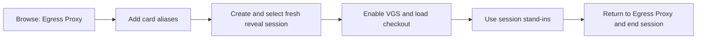

# Browser proxying best practices

[Docs](README.md) · [Control Panel](control-panel.md) · [MCP companion](mcp.md) · [Browser proxying](browser-proxying.md)

**Browse through your egress proxy first. Add the card and create a fresh reveal
session when you are ready to enter checkout, then enable VGS for the payment
flow.** Keep the same dedicated browser profile and egress configuration through
both stages.

This keeps browsing independent of the payment session's lifetime and leaves more
of that lifetime available for checkout. It does not guarantee that a merchant
will accept a request or a payment.

## Recommended sequence

| Stage | Route | Card and reveal session |
|---|---|---|
| Browse, sign in, choose items and prepare the basket | **Egress Proxy** | Defer creating the payment reveal session and fresh CVC alias |
| Prepare checkout | Keep **Egress Proxy** selected | Add the card or available aliases, then create a fresh reveal session with the same egress |
| Load checkout and enter payment details | **VGS Proxy**, or a verified **PAC File** | Select the fresh session and use its returned stand-ins |
| Finish testing or pause for a long time | Return to **Egress Proxy**; use **No Proxy** only when you intend to connect directly | Stop capture and end the reveal session when finished |

### 1. Configure egress before browsing

In **Browser Settings → Proxy Settings → Egress proxy settings**, choose **Enter manually**
and supply your authorized proxy's scheme, host, port and authentication. Save the
settings, select **Egress Proxy**, and confirm the selected route before opening
the merchant. If the selected session already has the intended egress, **Use
reveal session settings** is also available.

Use the same browser profile for browsing and checkout so its basket, cookies and
login remain available. Route changes apply to the browser profile's tabs, while
recording can target one selected tab.

**Current installer limitation:** `start-proxy-controls.py` still requires an
active session's original creation response in `--session` to generate the
extension. A new installation starts in PAC mode. Complete the [setup](control-panel.md#install),
then explicitly select **Egress Proxy** before browsing. The kit does not yet
support a first launch with no reveal session at all. The sequence here describes
the recommended payment-session timing once the panel is installed; it does not
remove that bootstrap requirement.

### 2. Add the card when checkout is ready

When the basket and other preparations are complete, open **Browser Settings → New
session… → Add card**. Use the hosted Collect fields to create the card number
and security code aliases, or choose **Add alias** for aliases that are already
available in the selected tenant and environment. Use public test cards for the
Sandbox walkthrough.

The order is **card aliases first, then reveal-session creation**: this form needs
the aliases in the create request. It does not create an empty reveal session and
attach the card afterward. PAN aliases are persistent; CVC aliases are volatile.
Creating another session cannot restore an expired or unavailable CVC alias, so
obtain a fresh one when needed.

### 3. Create the reveal session with matching egress

Check the environment and tenant. Configure the relevant destination rules,
allowed hosts and adapter for the checkout, including its payment provider. In
the new session's **Egress proxy** settings, use the same egress endpoint and
credentials used for browsing. Then create the session.

**Manual browser egress settings are not copied into new reveal sessions.** They
only control **Egress Proxy** mode. Supply the matching settings in the creation
form, or use a matching **Saved proxy** profile loaded by the helper. **VGS Proxy**
and **PAC File** use the egress recorded in the reveal session.

If your provider supports a sticky egress session, keep its identifier and
credentials consistent across both routes. Reusing a proxy hostname alone does
not guarantee the same public IP; that depends on the provider's configuration.

### 4. Switch before checkout sends card-related requests

Select the newly created session under **Available sessions** and click **Use
selected session**. Creating a session does not select it, and selecting it keeps
the current route: if you were using **Egress Proxy**, VGS is still off.

Start HAR recording before the checkout navigation you need to inspect. The
[MCP guide](mcp.md) describes selected-tab recording for an assistant. Then select
**VGS Proxy** before opening checkout or loading its payment frames. If checkout
is already open, reload it after switching and before entering the stand-ins;
requests already in progress may finish on their previous route.

**PAC File** is an alternative when you have inspected **Diagnostics → View
actual PAC file** and verified that all relevant payment hosts use VGS. PAC
matches destinations; it does not detect when you have reached checkout. In its
usual split, matching destinations use VGS then session egress; other destinations
use the PAC's egress or direct route.

Check that the session is active and its CA is trusted before using either VGS
route. Enter the new session's card-number and CVC stand-ins in the merchant form,
not vault aliases or the actual card. Do not wait until the final payment button
to switch: earlier requests or payment-frame initialization may need VGS too.
Session setup does not itself authorize submitting an order or payment.

### 5. Finish or pause

Stop and save the recording. Return to **Egress Proxy** if you are continuing to
browse through the same egress. Choose **No Proxy** only when you want a direct
connection from your computer. End the reveal session through your approved
session workflow when the test is finished; changing routes alone does not revoke
it. Do not leave an expired session selected in a VGS route for subsequent tests.

For a later attempt, check alias availability and create a fresh reveal session
near checkout. If you switch sessions after filling a payment form, replace the
old stand-ins with the newly selected session's values.

## Instruction for a browser agent

> Begin with Egress Proxy and confirm that route before browsing. Prepare the
> basket in the same dedicated browser profile. When checkout is ready, add the
> card through Collect or use available aliases, create a fresh reveal session
> with the same egress configuration, select it, and start capture. Enable VGS
> before loading checkout/payment frames, then use that session's stand-ins.
> Stop at the authorized testing boundary. Save the HAR, return to Egress Proxy,
> and end the reveal session when finished. If I request No Proxy, connect directly.

The current MCP tools provide capture and gateway operations; route changes and
session selection still use the control panel. An assistant needs browser control
or a person's help for those steps. See [session creation](control-panel.md#create-sessions)
and [MCP setup](mcp.md) for the supported interfaces.
