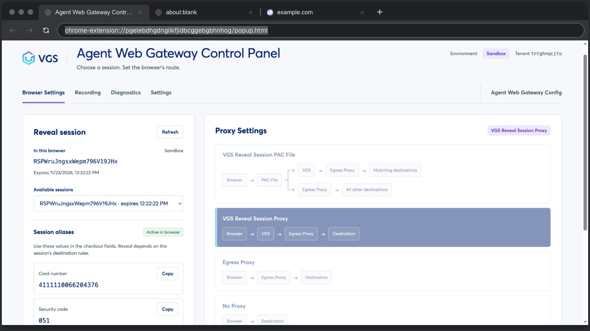
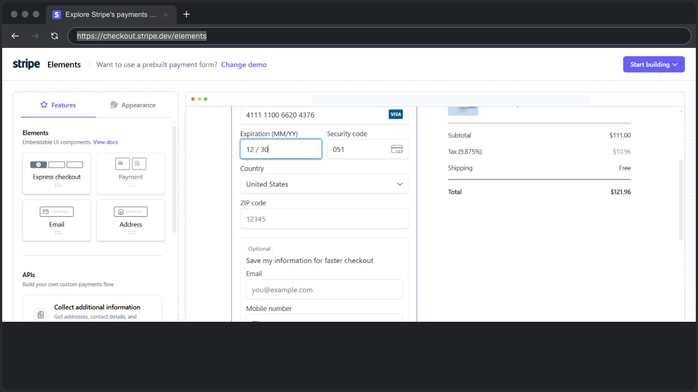

# Use Browser Use

[Browser Use](https://github.com/browser-use/browser-use) agents and [Browser Harness](https://github.com/browser-use/browser-harness) drive a browser through its Chrome DevTools address. `./awg browser-use` opens the kit's browser on a reveal session with that address available, so the agent's traffic passes through the session.

> Run so far: the local browser opens with the Control Panel and answers on its Chrome DevTools address. A Browser Use cloud browser starts on a session with the Control Panel loaded, and its pages load through VGS with the session's certificate authority trusted. The panel in the cloud browser loads the tenant, the session list and the session's stand-ins from the helper on this machine. A hosted Browser Use Cloud agent run on a session reached Stripe's Elements demo through VGS and typed the session's stand-ins into its payment form from secret bindings, stopping before submitting. Not yet exercised: creating a session or adding a card from the cloud panel, your own Browser Use agent driving the kit's browser, and a hosted run that submits an order so VGS reveals the card.

## Run it

```sh
./awg browser-use https://<the site to test>/
```

This is `./awg start` with one addition: the browser also listens for Chrome DevTools on `127.0.0.1:9222`. It needs the same things as `./awg start`, and the full Control Panel is loaded with its helper. Set `AWG_CDP_PORT` to use another port.

Point the agent at that address.

Browser Use library:

```python
from browser_use import Agent, Browser

browser = Browser(cdp_url='http://127.0.0.1:9222')
agent = Agent('<your task>', browser=browser)
print(agent.run_sync().final_result())
```

Browser Harness (the `browser-use` command line):

```sh
BU_CDP_URL=http://127.0.0.1:9222 browser-use <<'PY'
print(page_info())
PY
```

Browser Use releases change quickly, so pin the version you test with. These examples follow `browser-use==1.0.8rc1`, which needs Python 3.11 or newer.

## Give the agent the stand-ins

Give the agent the session's stand-ins, never a real card or the vault aliases. VGS replaces the stand-ins on the way to an approved destination. The Control Panel shows them, and the saved session file has them under `data.attributes.cards`.

Pass them through Browser Use's `sensitive_data`, so the agent types them with `type_secret(…)` and they stay out of its output and results:

```python
agent = Agent(
    "Fill the payment form: card number with type_secret('card_number'), security code with type_secret('card_cvc').",
    browser=Browser(cdp_url='http://127.0.0.1:9222', keep_alive=True),
    sensitive_data={'card_number': '<number stand-in>', 'card_cvc': '<security code stand-in>'},
)
```

`keep_alive=True` leaves the kit's browser open when the run ends. If you scope `sensitive_data` to domains, include the payment provider's host: payment fields usually sit in the provider's frame, not the shop's page.

[`examples/browser-use/checkout_agent.py`](../examples/browser-use/checkout_agent.py) does this end to end: it reads the stand-ins from the current session and stops before submitting the order. [`examples/browser-use/`](../examples/browser-use/README.md) also has a hosted Browser Use Cloud run.

```sh
uv run --with 'browser-use==1.0.8rc1' examples/browser-use/checkout_agent.py https://<the site to test>/
```

Browser Use 1.0 does not take a proxy for a browser it launches locally, so connecting it to a browser that is already on the session is the supported local route.

Any program on your machine can drive the browser through the DevTools address while it is open. Use it on a machine you control, and close the browser when you are done.

## Use a Browser Use cloud browser

`./awg browser-use --cloud` runs the browser in Browser Use's cloud, with its traffic passing through your reveal session. No browser or Docker is needed locally; the kit uses `curl`, `jq` and `uv`.

### What you need

- Sandbox credentials from `./awg setup`.
- A Browser Use Cloud account with custom proxies enabled for the project, and an API key. Custom proxies are an enterprise feature that Browser Use enables per project on request, and it bills browser usage to the account.

### Run it

```sh
./awg browser-use --cloud https://<the site to test>/
```

The first run asks for your Browser Use Cloud API key and saves it in `~/.vgs/awg/sandbox/browser-use-key`, readable only by you. Later runs use the saved key. A key in `BROWSER_USE_API_KEY` is used instead and saved the same way. To replace the saved key, run `./awg browser-use-login`.

[](images/browser-use-browser.png)

The command:

1. Creates or reuses a reveal session with the VGS test card, the same way `./awg start` does.
2. Starts the Control Panel's helper on your machine and uploads the Control Panel extension to Browser Use. If Browser Use does not accept it, the command says so and continues without the panel.
3. Starts a Browser Use browser that uses the session as its [custom proxy](https://docs.browser-use.com/cloud/browser/proxies), including the session's certificate authority so the browser trusts pages re-signed by VGS, and loads the panel.
4. Opens the kit's relay so the panel in the cloud browser reaches the helper on your machine. The helper holds your service-account credentials, and they stay local. Browser Use has no tunnel into its browsers, so the kit keeps a connection to the browser's Chrome DevTools address open and the panel hands each helper request to the kit over it ([`tools/browser-use/helper-relay.py`](../tools/browser-use/helper-relay.py)). The relay only ever calls the helper's own address.
5. Prints the browser's live view link and Chrome DevTools address, along with Browser Use's browser ID in case you need Browser Use support. Pass the DevTools address to `Browser(cdp_url=…)`, or set it as `AWG_CDP_URL` to run the example agent against the cloud browser.
6. Removes the browser and the panel, and stops the helper and relay, when you press Enter. Without a terminal, it runs until the browser closes after 30 minutes.

Type the session's stand-ins into the payment form, as in any other session. Read them with `./awg session` output or the Control Panel.

### What is different from `./awg start`

| | `./awg start` | `./awg browser-use --cloud` |
|---|---|---|
| Browser | CloakBrowser on your machine | Browser Use's cloud, viewed through a link |
| Needs | CloakBrowser license key | Browser Use API key, with custom proxies enabled |
| Also installed | CloakBrowser | Nothing |
| Control Panel | Loaded, with the local helper | Loaded and opened in a tab, with the local helper reached through the kit's relay |
| Session details and aliases | In the panel | In the panel |
| Route switching | In the panel | Not available. Browser Use refuses extensions that ask for the `proxy` permission, so the browser stays on the session it started with. A session you create in the panel needs a new `./awg browser-use --cloud` run to be used |
| Creating sessions, adding cards, scopes, gateway views | In the panel | In the panel, through the relay. Creating a session and adding a card are not verified in a Browser Use browser |
| Recording | In the panel | Not verified in a Browser Use browser |

To give the browser an egress proxy, start it with the name of a proxy saved in the Control Panel: `AWG_EGRESS="My proxy" ./awg browser-use --cloud`. See [Egress proxy](browserbase.md#egress-proxy).

### In your own code

The same thing is the `customProxy` field of `POST /api/v4/browsers`, or `browserSettings.customProxy` on an agent run: `host`, `port`, `protocol`, `username` and `password` from the session's proxy URL, and `caBundle` from the session's `ca_bundle`. With Browser Use's Python SDK, a hosted agent run on a reveal session looks like this:

```python
import json
from urllib.parse import unquote, urlsplit

from browser_use_sdk.v4 import BrowserUse

proxy = json.load(open("RS….json"))["data"]["attributes"]["proxy"]   # the reveal session you created
url = urlsplit(proxy["url"])

run = BrowserUse().runs.create(
    "<your task>",
    browser_settings={"customProxy": {
        "host": url.hostname, "port": url.port, "protocol": url.scheme,
        "username": unquote(url.username), "password": unquote(url.password),
        "caBundle": proxy["ca_bundle"],
    }},
)
```

[`examples/browser-use/cloud_run.py`](../examples/browser-use/cloud_run.py) is the full version: it also passes the session's stand-ins as secret bindings, so the agent types them without seeing them. This is the browser of a hosted run after the agent filled Stripe's Elements demo with the stand-ins:

[](images/browser-use-hosted-run.png)

Send `caBundle` rather than `ignoreCertErrors`: the browser then trusts only the session's certificate authority in addition to the public ones. A follow-up run that starts a new browser needs the proxy sent again.

### What Browser Use receives

The session's proxy address, proxy username and password, and certificate authority are sent to Browser Use's API, both as the custom proxy and inside the uploaded panel, and the browser's traffic runs in Browser Use's cloud. The live view link and the DevTools address each control the browser, so keep them private. Use Sandbox and the public test card only. Your VGS client secret is never sent to Browser Use: the helper that holds it runs on your machine. The panel in the Browser Use browser can call that helper through the relay while the command runs, and adding a card there uses a short-lived VGS access token in the browser.

### If it fails

| Output | Meaning |
|---|---|
| `BROWSER_USE_API_KEY is not set and no Browser Use Cloud API key is saved` | The command had no terminal to ask in. Run `./awg browser-use-login` in your own terminal once. |
| `Browser Use answered HTTP 401` | Browser Use did not accept the key. |
| `Browser Use answered HTTP 403` | Custom proxies are not enabled for the Browser Use project. They are an enterprise feature that Browser Use enables on request. |
| `Browser Use did not accept the Control Panel` | The browser still starts on the session, without the panel. |
| `The local helper did not start` | The panel shows session details only. The private log named in the message has the reason. |
| The panel shows "Check the local helper" | The relay lost its connection to the browser. Stop the command and run it again. |
| Pages fail to load in the Browser Use browser | The session expired, or Browser Use cannot reach the session's proxy host and port. |
