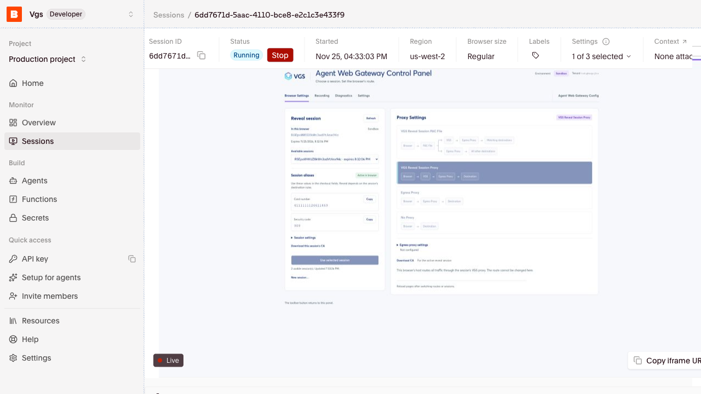

# Use a Browserbase cloud browser

`./awg start` opens CloakBrowser on your machine. `./awg browserbase` is an alternative for teams that run their agents on [Browserbase](https://www.browserbase.com): the browser runs in Browserbase's cloud and its traffic passes through your reveal session. No browser or Docker is needed locally; the kit uses `curl`, `jq` and `uv`.

> Run against Browserbase's service: the browser started on the session's proxy with the session's certificate authority trusted, pages loaded through VGS with a `vgs-request-id`, and the Control Panel loaded, opened, and connected to the local helper through the relay, showing the tenant, the session and its stand-ins. Not yet exercised: `AWG_EGRESS`, creating a session or adding a card from the panel in a Browserbase browser, the payment example, and a submitted payment.

## What you need

- Sandbox credentials from `./awg setup`.
- A Browserbase project on the Developer plan or higher, and its API key. Browserbase requires that plan for custom proxies and keep-alive browsers, and bills browser usage to the account.

| Variable | Purpose |
|---|---|
| `BROWSERBASE_API_KEY` | Optional. The project's API key, used instead of the saved one and saved the same way. |
| `BROWSERBASE_PROJECT_ID` | Optional. Browserbase reads the project from the key; set this when the key covers more than one. |
| `AWG_EGRESS` | Optional. The name of a proxy saved in the Control Panel. See [Egress proxy](#egress-proxy). |

## Run it

```sh
./awg browserbase https://<the site to test>/
```

The first run asks for your Browserbase API key and saves it in `~/.awg-dev-kit/browserbase-key`, readable only by you. Later runs use the saved key. To replace it, run `./awg browserbase-login`.

[](images/browserbase-browser.png)

Browserbase's live view does not draw a browser's own dropdown lists, so in a hosted browser the panel opens each list inside the page.

The command:

1. Creates or reuses a reveal session with the VGS test card, the same way `./awg start` does.
2. Starts the Control Panel's helper on your machine and uploads the Control Panel extension to Browserbase. If Browserbase does not accept it, the command says so and continues without the panel.
3. Uploads the session's certificate authority to Browserbase's [certificates](https://docs.browserbase.com/platform/browser/security/certificate-validation), so the browser trusts pages re-signed by VGS and nothing else new.
4. Starts a Browserbase browser that uses the session as its [external proxy](https://docs.browserbase.com/platform/identity/proxies), trusts that certificate authority, and loads the panel.
5. Opens the kit's relay so the panel in the cloud browser reaches the helper on your machine. The helper holds your service-account credentials, and they stay local. The kit keeps a connection to the browser's connect address open and the panel hands each helper request to the kit over it ([`tools/browser-use/helper-relay.py`](../tools/browser-use/helper-relay.py)). The relay only ever calls the helper's own address.
6. Prints a live view link for the Control Panel's tab and one for the website's tab, since Browserbase's live view shows one tab per link, and the browser's connect address, along with Browserbase's session ID for its dashboard, session replay and support. Pass the connect address to Playwright's `connect_over_cdp`, Stagehand, or your own agent.
7. Releases the browser, removes the panel and the certificate, and stops the helper and relay, when you press Enter. Without a terminal, it runs until the browser closes after 30 minutes.

Type the session's stand-ins into the payment form, as in any other session. Read them with `./awg session` output or the Control Panel.

## Egress proxy

A Browserbase browser stays on the session it started with, so the [egress proxy](browser-proxying.md) has to be part of that session. Name a proxy you saved in the Control Panel when you start the browser:

```sh
AWG_EGRESS="My proxy" ./awg browserbase https://<the site to test>/
```

The kit creates the session with that proxy as its `egress_proxy_settings`, so traffic goes from the Browserbase browser to VGS, and from VGS through your proxy to the website. The proxy's address and credentials are sent to VGS only, not to Browserbase. A current session is reused only when it already goes out through the named proxy. `AWG_EGRESS` works the same way with `./awg session` and the other browser commands.

To save a proxy, open **Egress proxy** in the panel's new-session form and choose **Add a new proxy…**. Saved proxies are kept on your machine in `~/.awg-dev-kit`. Choosing a different proxy in the panel creates a new session, which this browser cannot switch to; run the command again with `AWG_EGRESS` instead.

## What is different from `./awg start`

| | `./awg start` | `./awg browserbase` |
|---|---|---|
| Browser | CloakBrowser on your machine | Browserbase's cloud, viewed through a link |
| Needs | CloakBrowser license key | Browserbase API key, on the Developer plan or higher |
| Also installed | CloakBrowser | Nothing |
| Control Panel | Loaded, with the local helper | Loaded and opened in a tab, with the local helper reached through the kit's relay |
| Route switching | In the panel | Not available. Browserbase sets the browser's route, so the browser stays on the session it started with |
| Recording | In the panel | Not verified in a Browserbase browser. Browserbase keeps its own session replay |

## In your own code

The same thing is two calls to Browserbase's API. Upload the session's `ca_bundle` with `POST /v1/certificates`, then create the browser with `POST /v1/sessions`:

```python
import json
from urllib.parse import unquote, urlsplit

proxy = json.load(open("RS….json"))["data"]["attributes"]["proxy"]   # the reveal session you created
url = urlsplit(proxy["url"])

browser = {
    "proxies": [{"type": "external", "server": f"{url.scheme}://{url.hostname}:{url.port}",
                 "username": unquote(url.username), "password": unquote(url.password)}],
    "proxySettings": {"caCertificates": ["<id of the uploaded certificate>"]},
}
```

[`examples/browserbase/payment_flow.py`](../examples/browserbase/payment_flow.py) is the full version: it starts the browser, opens a vendor's payment page with Playwright, types the session's stand-ins, and submits only when asked to.

Send the certificate rather than `browserSettings.ignoreCertificateErrors`: the browser then trusts only the session's certificate authority in addition to the public ones. Each reveal session has its own certificate authority and proxy password, so a new session needs a new upload and a new browser.

## What Browserbase receives

The session's proxy address, proxy username and password, and certificate authority are sent to Browserbase's API, and the proxy details are also inside the uploaded panel. The browser's traffic runs in Browserbase's cloud, where its session replay records what the pages show, including the stand-ins typed into them. The live view link and the connect address each control the browser, so keep them private. Use Sandbox and the public test card only. Browserbase never receives the card: the browser holds session stand-ins, and VGS replaces them after the request has left the browser. Your VGS client secret is never sent to Browserbase: the helper that holds it runs on your machine.

## If it fails

| Output | Meaning |
|---|---|
| `BROWSERBASE_API_KEY is not set and no Browserbase API key is saved` | The command had no terminal to ask in. Run `./awg browserbase-login` in your own terminal once. |
| `Browserbase answered HTTP 401` | Browserbase did not accept the key. Save a new one with `./awg browserbase-login`. |
| `Browserbase answered HTTP 402` or `403` | The project's plan lacks custom proxies or keep-alive browsers. |
| `Browserbase did not store the session's certificate authority` | The certificate upload was refused; the line above it has Browserbase's reason. |
| `Browserbase did not start the browser` | Browserbase checks the proxy when it creates the browser. The line above has its reason; the session may have expired, or Browserbase cannot reach the session's proxy host and port. |
| `Browserbase did not accept the Control Panel` | The browser still starts on the session, without the panel. |
| `Control Panel: not loaded in this browser` | The panel was not found among the browser's extensions. Read the stand-ins from the session file. |
| `no saved proxy is named …` | `AWG_EGRESS` does not match a proxy saved in the Control Panel. The message lists the saved names. |
| Pages fail with a certificate error | The browser is not trusting the session's certificate authority. Report it with the Browserbase session ID. |
