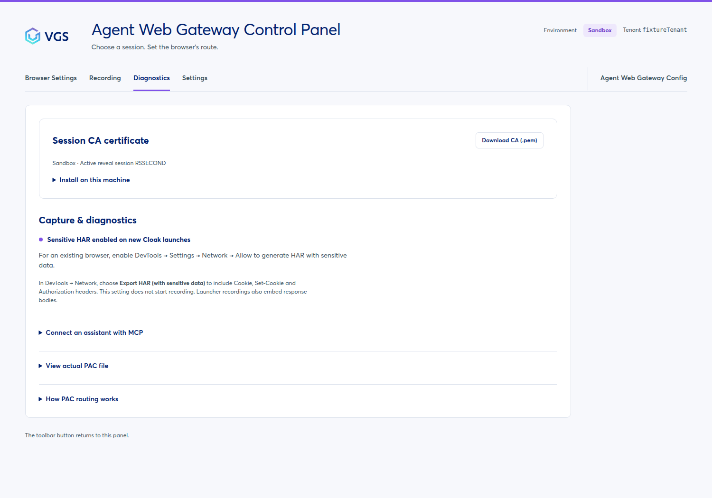

# Agent Web Gateway Control Panel

[Docs](README.md) · [Control Panel](control-panel.md) · [MCP companion](mcp.md) · [Browser proxying](browser-proxying.md)

A VGS-branded, full-page Chromium extension with a local companion. It displays
the selected tenant and service-account permissions, creates/selects reveal sessions,
shows the actual PAC file, and selects one of four browser routes:

1. VGS Reveal Session PAC File — the session's host-based routing rules.
2. VGS Reveal Session Proxy — VGS proxy followed by that session's configured egress.
3. Egress Proxy — the session's egress or a manually configured proxy, without VGS replacement.
4. No Proxy — direct connection from this computer.

The documentation shortens the first two names to **PAC File** and **VGS Proxy**.

In **Add card**, Sandbox offers the same **Test cards** shortcuts as the dashboard: Visa · 4242, Visa · 4111, and Mastercard · 5454. Choosing one fills the hosted fields with its public test PAN, CVC 123, and December expiry three years ahead when expiry is required. It does not create aliases or a session. Test shortcuts are hidden in Live and never save the selected card between openings.

Contextual documentation links open the official reveal-session, PAC, Collect, adapter, and service-account references in a new tab, keeping your form open.

Version 1.10.0. Choose Sandbox or Live in **Settings → Environment**. Each environment
uses its own service-account credentials and saved session directory. New tabs
default to Sandbox. The screenshots below use synthetic data from local fixtures;
actual service availability and permissions depend on your account.

## Start with the dev kit

From the cloned repository, run:

```sh
./awg setup
./awg start
```

`./awg start` creates or reuses an active test-card session and opens CloakBrowser
with the Control Panel. The [setup guide](setup.md) covers account setup and
recovery. The [browser launch examples](training/10-proxy-controls-extension.md#browser-launch-examples)
cover Chrome for Testing, Chromium, Chrome, Edge, and Brave.

Browse through **Egress Proxy**, then create a fresh payment reveal session with
the same egress near checkout. Follow [Browser proxying best practices](browser-proxying.md)
for the route changes, session timing, and cleanup.

For the standalone extension package, use the [download and build guide](training/extension-distribution.md#download-or-build-the-kit).
Artifacts require GitHub sign-in and expire after 30 days. The download contains
source and a helper; run the helper with your own account and session before
loading the generated extension. The manual installation steps follow below.

## Install

Requires Python 3.10+ and a Chromium browser that supports unpacked Manifest V3
extensions (for example, your existing CloakBrowser or Chrome for Testing).
The base helper uses Python's standard library; no Python packages are needed.
The optional [MCP companion](mcp.md) adds selected-tab recording, full HAR access
and gateway authoring tools for a connected assistant, with its own dependencies.
In **Settings → Service account**, use **Browse…** to choose a local credentials
file, or enter its path. Selection fills the path; **Connect account** loads it.
Cancelling leaves the current path unchanged. The native file explorer runs on
the helper's computer (macOS, Windows, or Linux with Zenity/KDialog installed).
Only the selected path reaches the extension; file contents remain in the helper.
Use a dedicated browser already configured with the reveal session's
VGS CA through your team's approved browser setup. This extension does not install
certificates or disable TLS verification.

1. Unzip the standalone package into a folder you will keep. If you cloned the
   repository and want to run the helper by hand, copy its source to a private
   working folder outside the checkout:

   ```sh
   cp -R tools/vgs-proxy-controls "$HOME/vgs-proxy-controls"
   ```

   Keep the folder intact. Run the commands below from that folder.
2. If you cloned the full dev kit, run `./awg setup` at its root. It installs VGS CLI
   with `uv`, runs `vgs login`, asks for your organization, and creates the
   Sandbox service credentials automatically. Use `~/.awg-dev-kit/sandbox.env`.
   See the [setup guide](setup.md).
   For this standalone package, use an existing private credentials file or copy
   `sandbox.env.example` outside the package and fill it locally. Session operations need both
   `reveal-sessions:read` and `reveal-sessions:write` access to the selected vault.
   Card creation needs `cards:create`; Vault API tokenization needs `aliases:write`.
   The dev kit's setup definition includes `cards:create`, `cards:read`, and
   `cards:update`, without card deletion or PAN/CVC read access. It works with
   VGS CLI 1.36.0, which does not include an `agent-web-gateway-admin` template. The panel
   displays the exact granted scope names and also supports existing accounts
   with legacy `cards:write`; it does not change the account’s permissions.
   **Settings → Service account → Permissions** lists all eight scopes the kit uses
   and whether each is in the token's `scope` claim, which is what the APIs check.
   If any is missing, the panel shows `Scope error: … token is missing …` in
   Settings and on the main view, and says whether a new account
   (`./awg setup --force`) fixes it or whether VGS left a granted scope out of
   the token. The MCP `gateway_account` tool returns the same list as `missingScopes`.
   Use plain `KEY=value` lines, without shell `export`
   prefixes or quotes. On macOS/Linux, restrict it with `chmod 600 /path/sandbox.env`.
3. Keep the original reveal-session creation responses in a private directory,
   named `RS….json`. The API list cannot retrieve their one-time proxy credentials.
   For a session with authenticated custom egress, keep its original creation
   request beside it as `RS….request.json`; the response masks the egress password.
   Create sessions using your existing approved workflow.
4. From that working folder, run:

   ```sh
   python3 start-proxy-controls.py \
     --environment sandbox \
     --session /path/to/sessions/RS_EXAMPLE.json \
     --credentials-file /path/to/sandbox.env \
     --sessions-dir /path/to/sessions
   ```

   Replace `RS_EXAMPLE.json` with your actual session file. Keep this Terminal open.
   Use `--check` to validate these inputs locally without contacting VGS.
5. In the test browser, open `chrome://extensions`, enable Developer mode, choose
   **Load unpacked**, and select the `.private-extension` directory printed by the
   command. Pin **Agent Web Gateway Control Panel** from the extensions menu and open it.

After restarting the helper, click **Reload** for this extension on
`chrome://extensions` to reconnect to the new local helper. The browser's selected
session survives worker restarts. A newly installed extension starts in PAC mode.
Stop the helper with Ctrl-C when finished. An already selected route continues to
use its session; Refresh and changing sessions need the helper running.

### Load from the command line on macOS

Run the helper above first, with an active session, and leave its Terminal open.
In a second Terminal, launch **Chrome for Testing** or Chromium with the generated
directory. This example uses Chrome for Testing installed in `/Applications`:

```sh
AWG_EXTENSION_DIR="/absolute/path/to/.private-extension"
"/Applications/Google Chrome for Testing.app/Contents/MacOS/Google Chrome for Testing" \
  --user-data-dir="$HOME/Library/Application Support/AWG Testing/chrome-for-testing" \
  --load-extension="$AWG_EXTENSION_DIR" \
  --no-first-run
```

Use the actual browser executable path on your computer and a dedicated profile.
Close that dedicated browser before running the command again; an existing process
may ignore the new launch flags. The control panel opens automatically. A new
installation starts in PAC mode; choose **No Proxy** in the panel to turn it off.
Use the same profile directory for later launches to retain extension settings.
The VGS CA still needs to be trusted through your approved browser setup before
using reveal proxy routes.

Regular Google Chrome removed `--load-extension` in Chrome 137; see the
[Chrome team's announcement](https://groups.google.com/a/chromium.org/g/chromium-extensions/c/1-g8EFx2BBY/m/S0ET5wPjCAAJ).
For regular Chrome, load it once through `chrome://extensions` → **Developer mode**
→ **Load unpacked**, selecting the generated `.private-extension` folder containing
`manifest.json`. On macOS, **Cmd+Shift+G** in the folder chooser lets you enter the
hidden folder's full path. Keep the folder in place and keep the helper running.
After that first installation, you can launch Chrome normally from the CLI:

```sh
open -a "Google Chrome"
```

Share the clean ZIP, not the generated private directory. Each recipient runs the
helper with their own account and session before loading their generated extension.

## Recommended browser workflow

Browse through **Egress Proxy** first. When checkout is ready, add the card aliases,
create a fresh reveal session using the same egress settings, select it, and enable
VGS before loading checkout or its payment frames. Manual browser egress settings
are not automatically copied into new sessions, and session selection preserves
the current route. See [Browser proxying best practices](browser-proxying.md)
for the full sequence, PAC routing, recording and cleanup. The current installer
still requires an active saved session for initial setup and starts in PAC mode;
select **Egress Proxy** before browsing.

## Walkthrough screenshots

All screenshots use synthetic Sandbox data and local fixtures. They do not show
real credentials, a live session or merchant traffic.

**Browser Settings:** select a saved session, then choose a route. **No Proxy** turns proxying off.


**Settings:** confirm the environment and tenant; browse for your service-account file.


**New session:** open the form when needed and use hosted card fields or existing aliases.


**Diagnostics:** inspect the actual PAC script and sensitive-HAR export setting,
or expand **Connect an assistant with MCP** for its local client configuration.



**Agent Web Gateway Config:** inspect destinations and adapters. Each adapter
contains its functions and connected destinations; destination details show the
function inputs. This panel is read-only.


## Use

### Automatic test recording

In the **Recording** tab, enter a merchant address and click **Start test**.
The helper attaches its recorder before opening the address in a new tab. Use
**Find tabs** to select an existing tab instead; leave the address blank to start
recording without reloading it. Redirects and requests from payment frames remain
in the same HAR without opening DevTools or enabling its Preserve log checkbox.

The panel shows recording progress and **Stop and save HAR**. Closing the test tab
also saves automatically. Closing only the panel leaves recording active. HARs
are checkpointed every five seconds to the private `test-captures` directory next
to the sessions directory; `--captures-directory` overrides it. Files use mode
0600 and the directory 0700. Failed/in-flight requests, unavailable bodies and
capture limits are reported. An abrupt helper exit may leave an incomplete checkpoint.

Install `requirements-recording.txt` into the helper's Python environment. Launch
the dedicated testing browser with local debugging as described in [the MCP guide](mcp.md#2-launch-a-dedicated-browser-with-local-debugging).
The panel recorder discovers the debugging port from `--capture-profile` when provided,
otherwise it uses `http://127.0.0.1:9222`; pass
`--recording-browser-url` to the helper for another loopback port. No MCP client,
`--enable-mcp`, gateway-write access, or additional service-account scopes are
required. If the browser cannot be reached, no test navigation starts.

Only the selected test tab and its frames are recorded; new tabs/popups require
their own recording. Secure VGS tokenization and loopback helper requests are
excluded. Other captured headers and bodies are unredacted and may include checkout
details. Panel status never returns them. The HAR shows the browser's requests
before gateway transformations, not proof that a payment or reveal succeeded.

To record a selected tab for Claude or another assistant, follow [MCP setup](mcp.md).
Start the helper with `--enable-mcp` and launch the dedicated browser with local
debugging. This exposes unredacted captured headers/bodies through explicit MCP
tools. Optional gateway writes require `--mcp-write` and the configured account's
permissions. MCP does not switch proxy routes or submit a checkout automatically.

**Available sessions** lists active sessions from the account. Click **Refresh**
to include sessions created after opening the browser. Entries without locally
saved credentials or a compatible CA explain why activation is unavailable. You can
select an entry to inspect its details; **Use selected session** is enabled only for
a usable session. A current expired session remains visible.

Choose an entry, then click **Use selected session**. The current PAC / VGS /
egress / direct mode is kept. Switching briefly blocks routing and resets cached
authentication for the proxy endpoints so Chrome uses the new session's credentials.
Merchant cookies, tabs and history are preserved. Switching to a session without
custom egress is refused while Egress Proxy mode is selected unless a manual proxy is configured. An interrupted
switch stays blocked until you explicitly choose a route.

Session aliases are specific to the session: re-enter the newly selected session's
session aliases in existing checkout forms. The extension does not fill checkout forms or submit orders/payments. Reload pages after switching;
requests already running may finish on their previous route.

**Proxy Settings** shows four horizontal flow diagrams. Expand **Egress proxy settings**
to choose the session configuration or enter an HTTP/HTTPS hostname, port, and
optional username/password. Save first, then choose **Egress Proxy**. Saving while
already in that mode applies the change immediately. Manual settings persist in
this browser and across session changes. Saved credentials are never returned to
the page; leave both fields empty to retain them for the same endpoint, or turn
off Proxy authentication to remove them. Manual settings only affect Egress Proxy
mode; PAC and VGS Proxy retain their session's egress. The actual PAC script is
authoritative for destination routing.

**Diagnostics → View actual PAC file → Load PAC script** retrieves and displays the actual routing
script, with a fetch timestamp. The displayed PAC source omits its private signature.
PAC means Proxy Auto-Configuration; it chooses routes by host and does not detect
checkout. For checkout-only VGS routing, choose Egress Proxy while browsing, then
VGS Proxy before opening checkout.

## Certificates

**Download CA** in Proxy Settings follows the active browser session. The download
inside Session aliases follows the selected session, which may not yet be active.
Install and trust the certificate through your operating system; the extension does
not change trust. On macOS, the helper checks existing local SSL trust when a session
uses a different CA. On other systems, start a helper/browser configured for that CA.
The extension preserves the proxy host and supported port returned by the session API.

## Environment profiles

The main view contains session selection and Proxy Settings. Open **Settings**
for the environment and service-account file; **Diagnostics** contains HAR and PAC details.

In Settings, choose the environment, enter the full local path to a credentials
file, and click **Connect account**. `~/` paths are supported. The helper reads the
file locally, verifies authentication and session-read access, and remembers the
path in a private `.proxy-controls-accounts.json` beside its sessions directory.
No restart or browser reload is needed. The file contents never enter the extension.
Failure keeps the previously connected account; changing accounts keeps the current
browser route/session. New accounts receive separate session-storage directories.

Expand **Create a service account with the CLI** beside the file picker for a
copyable login → generate → review → apply → connect walkthrough. Commands follow
the selected environment and save the one-time credentials in a
private file without overwriting an existing file. The guide requires a CLI build
containing `agent-web-gateway-admin`; it does not execute commands or create an
account from the extension. For the stable CLI release, use `./awg setup` from
the full dev kit instead. Choose the resulting credentials file with **Browse…**,
then **Connect account**.

Supported formats are the dashboard's downloaded `clientId="…"` / `clientSecret="…"`
text file, CLI `kind: ServiceAccount` YAML/JSON (with `data.clientId`,
`data.clientSecret`, and `data.vaults`), `VGS_CLIENT_ID` / `VGS_CLIENT_SECRET` environment files, and JSON using
`client_id` / `client_secret` (or the corresponding camelCase/environment keys).
The tenant is detected automatically from the file or the authenticated account’s
`vgs.io/vault-id` token annotation. Tenant discovery uses this metadata locally;
there is no account API or tenant-list lookup. If the metadata is missing, connect
a tenant-scoped account or its CLI credentials export. No extra permission is needed.
A single tenant connects immediately. Several tenants show a selector; no tenant ID
needs to be typed. The chosen tenant must pass session-read authorization before it
is saved. JSON API creation responses using `data.attributes.client_id` /
`client_secret` are also accepted. API/auth domains follow the selected environment automatically;
explicit environment or endpoint values in a file must match it.

**New session…** opens account setup when the environment is unconfigured or lacks
creation permission, with a visible explanation. Connect an account granting
`reveal-sessions:read` and `reveal-sessions:write`, then return to Browser Settings and open
the form. **Add card** opens VGS Collect hosted card-number and security-code fields, authorized by the account connected in Settings. It uses `aliases:write` when available, or Collect’s card-creation API with `cards:write` / `cards:create`; no Terminal tokenizer is required.

API and authentication domains follow the selected environment. The session's signed
PAC URL and proxy credentials come from its original response and are never
rewritten by changing a domain suffix. See the
[VGS API reference](https://docs.verygoodsecurity.com/cmp/developer-resources/api).

Supply matching credentials, session and session directory with `--environment
sandbox` or `--environment live`. Explicit endpoint values in a credentials file
must match that environment; mismatches are rejected before authentication.

For more than one environment, copy `environments.example.json` to a private
location, replace its paths, and pass `--profiles-file /path/to/environments.json`.
Include only **additional** environments (omit the startup environment). Each
profile needs `credentials_file` and a distinct `sessions_directory`; `egress_file`
and `tokenizer_socket` enable creation. Use absolute paths and chmod 600. An app
launcher may instead load this mapping under `environments` in its private
`.proxy-controls.json`. There is no fallback to another environment's credentials,
tokenizer, egress profile, or session directory.

The choice persists across worker restarts. Selecting an unconfigured environment
shows account setup guidance without making remote requests. Changing the
setting updates the list and creation context; the browser keeps its current
session and route until **Use selected session**. The panel identifies that session's
environment, including when it differs from the setting. Sessions requiring another
CA require matching local SSL trust on macOS, or a new helper/browser configured for that CA on other systems. PAC inspection uses the browser's
current session even while another environment is selected in Settings.

Use the same `--environment` with the private tokenizer. Its socket protocol
checks both environment and tenant before accepting aliases.

## Gateway configuration

**Agent Web Gateway Config** follows the dashboard hierarchy: **Destinations** and
**Adapters**. The adapter registry opens each adapter's **Functions** and
**Connected destinations**, grouped by host. Open a function to inspect its code and
inputs; open a destination to inspect its conditions and input mappings. Breadcrumbs
return to the adapter. **Default** contains the review queue and destination policy.
There are no standalone Functions or Connections tabs. This view is read-only and
refreshes while visible; it never approves guarded destinations automatically.

## Create sessions

The **New session…** control opens a dashboard-style creation view on demand,
with **Cards and aliases**, a searchable **Adapter** selector, **Allowed hosts**,
**Allowed client addresses**, and **Egress proxy** settings. Cancel returns to
Browser Settings. Creation never automatically switches this browser to the new session.

**Add card** uses VGS Collect and the connected service account to add both aliases to the
form. **Add alias** accepts existing `tok_sandbox_…` (Sandbox) or `tok_live_…`
(Live) aliases. Each row specifies its format, storage, and applicable BIN/length.
Card number and security code aliases must be paired: PAN is PERSISTENT; CVC is
VOLATILE. Text aliases are also supported. Card inputs stay inside VGS-hosted frames; the panel receives aliases and validation metadata.

Choose **Automatic** for destination bindings, or select an available registered
or tenant adapter. The helper verifies the selected adapter before creating a
session. Exact hosts and client IPs/CIDRs are optional. Adapters requiring extra
context still need their specialized workflow.

When the app loads an egress profile, the creation form shows **Saved proxy** and the
helper supplies its saved endpoint and credentials. Host inputs and route diagrams contain no example hostnames. Its private JSON has `scheme` (`http` or
`https`), `hostname`, integer `port`, `username`, and `password`; keep it outside
the package with mode 0600. Without a loaded profile, the form supports explicit
**None**, a saved proxy, or **Add a new proxy…**. Give each proxy a local name; its credentials remain in the helper’s private `.proxy-controls-egress.json` file. You can also save the current browser egress for reuse. Existing sessions keep their original egress.

The included private tokenizer remains available for CLI workflows (it is optional for the control panel):

```sh
python3 private-card-tokenizer.py --environment sandbox --credentials-file /path/to/sandbox.env \
  --socket /path/to/private/card.sock --method cards
```

Card inputs are hidden Terminal prompts and stay in the tokenizer’s memory for up
to 12 hours or until Ctrl-C. The `cards` method uses POST /cards and requires both
returned aliases. `--method aliases` explicitly uses the tenant’s selected Vault
API and requires `aliases:write`. It tokenizes PAN as PERSISTENT and CVC as VOLATILE.
No raw card values are accepted by the local helper or saved by the tokenizer.
Existing approved-card socket helpers using this protocol are also supported;
use your organization’s approved tokenizer where required.

Creating saves the one-time response and matching request privately (0600), then
returns to **Browser Settings**, selects the new entry for inspection, and shows a
success notice and copyable session aliases under **Session aliases**. **Session settings**
includes expiry, destination and client restrictions, adapter, proxy endpoints, and
a CA download. These details load from the saved creation response when reopening
the panel, so session aliases are available later too. The badge distinguishes the
selected entry from the active browser session. Click **Use selected session** to switch.
The selected route stays unchanged. Creation uses an asynchronous operation ID
and persistent journal: retries cannot duplicate the same POST. After an uncertain
network result, check the list and local files before starting a new request.
A helper interruption is reported as uncertain, never automatically retried.

`--slot-file` optionally coordinates session creation with an existing local test
lock. The helper also accepts private defaults from `.proxy-controls.json` beside
its source: `egress_file`, `tokenizer_socket`, `slot_file`, and `capture_profile`.
Never include that private file or `.proxy-controls-accounts.json` in a distributed package.

## Sensitive HAR and browser startup

`capture_preferences.py` can seed **Allow to generate HAR with sensitive data** and
**Keep log** in a fresh browser profile before its first launch; it refuses to
overwrite existing preferences. A browser launcher has to call it. No launcher in
this repository does, including the one `./awg start` uses. The panel shows
the setting read from `--capture-profile` when provided. For another existing
browser, enable DevTools → Settings → Network → Allow to generate HAR with sensitive
data once. Chromium extensions cannot change DevTools preferences directly.

In Network, select **Export HAR (with sensitive data)**. Merely enabling the
setting adds the export choice; it does not start recording. To record without
DevTools, use the panel's **Recording** tab (see [Automatic test recording](#automatic-test-recording)).
HAR files can contain credentials, cookies, and request/response data; keep them
private. The packaged standalone helper does not include or launch CloakBrowser.

The toolbar button opens or focuses the full control-panel tab. Layout adapts
to narrow windows.

## Share this package

Share the original `vgs-agent-web-gateway-control-panel-1.10.0.zip`, or rebuild it using the included
`build-package.py`. The builder uses a fixed allowlist and produces a clean ZIP.

**Never share `.private-extension`, a loaded browser profile, your environment
file, or saved session/request JSON files.** The generated extension contains your
session's proxy credentials and signed PAC URL. Do not export the installed
extension with Chrome's “Pack extension” button. Each recipient generates their
own private extension using the steps above.

The account API credentials remain in the local helper. Its HTTP interface binds
only to `127.0.0.1`, requires a random access token, rejects website origins, and
supports narrowly defined account-status, session/PAC reads, and journaled session creation. It does not expose a general-purpose
API proxy. Public UI messages omit credentials and signed PAC URLs.

## Troubleshooting

- **No usable sessions:** create a fresh session through your approved workflow,
  save its creation response and matching request in `--sessions-dir`, then Refresh.
- **Proxy credentials not saved:** GET/list API responses are insufficient; use the
  original creation response. Credentials are returned only at creation.
- **Missing saved egress credentials:** put the matching `.request.json` beside the
  response. Do not substitute a different proxy's credentials.
- **Could not refresh:** keep the helper running, confirm the service account's selected-environment
  access, then Refresh. After a helper restart, reload the extension first.
- **Different session CA:** use a fresh browser configured for that session's CA.
- **Session expired:** select a fresh available session. Expiry does not prove that
  a backing CVC alias is still available; use fresh aliases for new checkout tests.

## Inline card entry

Connect your service-account file in Settings, open **New session → Add card**, and enter the card number and security code in the VGS-hosted fields. Choose **Create aliases**, then create the session. PAN uses persistent UUID aliases; CVC uses volatile UUID aliases. The card is not charged. Expiry appears when using the card-creation API. The direct alias flow does not require it.

Card lengths default to 16/3 and adjust to 15/4 for Amex or 14/3 for Diners Club. For other lengths, expand **Card lengths**. Collect validates the number of digits inside the hosted fields before submission, so the session aliases match.

Service-account secrets stay in the helper. Collect receives a transient access token with that account’s existing permissions; the extension does not persist it. It never receives raw PAN/CVC values. A failed or incomplete alias response is rejected. The terminal tokenizer remains available for automated CLI workflows. See [COLLECT-SDK.md](../tools/vgs-proxy-controls/COLLECT-SDK.md) for bundled SDK sources.

Recordings made from the panel's **Recording** tab use `capture_preferences.har_recording_filter()` to exclude VGS Collect, Vault/Cards API, and loopback helper traffic. Card values are visible inside the hosted fields; screen/video captures can include them. This filter applies to panel recordings; a manually exported DevTools HAR is controlled by DevTools.

An account with `aliases:write` creates fresh PAN/CVC aliases directly. A card-write account uses Collect’s Cards API. If that API returns an existing card without a fresh CVC alias, the panel rejects the incomplete result and asks for an account with `aliases:write`. Existing CVC aliases are never silently reused.

The [capture review workflow](../tools/vgs-proxy-controls/REPAIRS.md) describes how to inspect HAR evidence and validate destination or adapter changes. Automatic destination repair is unavailable in customer environments; use explicitly authorized gateway operations after validation.

## Use with a coding assistant

Give your assistant this repository and the following setup request:

> Help me install the Agent Web Gateway Control Panel using the repository's
> browser walkthrough. Check my Python and browser versions, use my local Sandbox
> credentials and original saved session response, and create a dedicated browser
> profile. Keep credential contents out of chat and source control. Start the helper,
> launch the browser, and help me verify the tenant, selected session, and proxy route.
> Follow Browser proxying best practices: browse through Egress Proxy, then add the
> card and create a fresh payment reveal session with the same egress near checkout.
> Do not submit a merchant payment.

The assistant needs access to your computer to execute those steps. The repository
and extension alone do not grant it browser control or access to HAR recordings.


Connect the assistant to captures and gateway tools with the [MCP companion guide](mcp.md).
