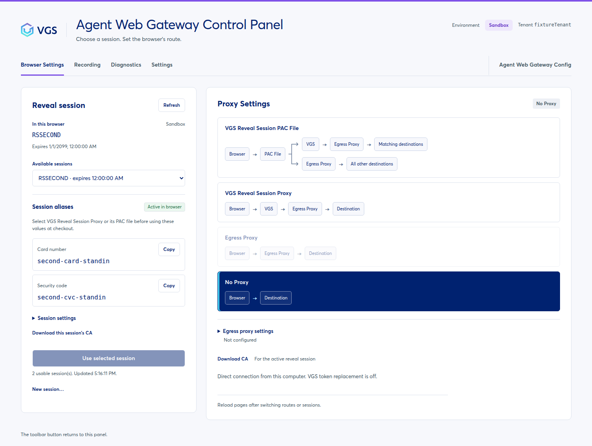
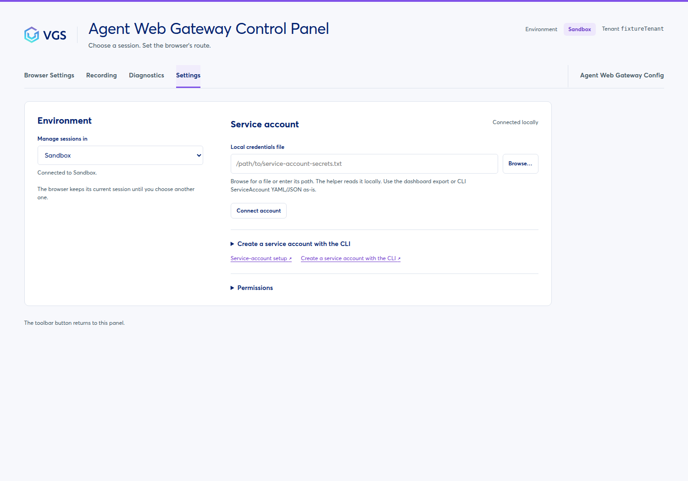
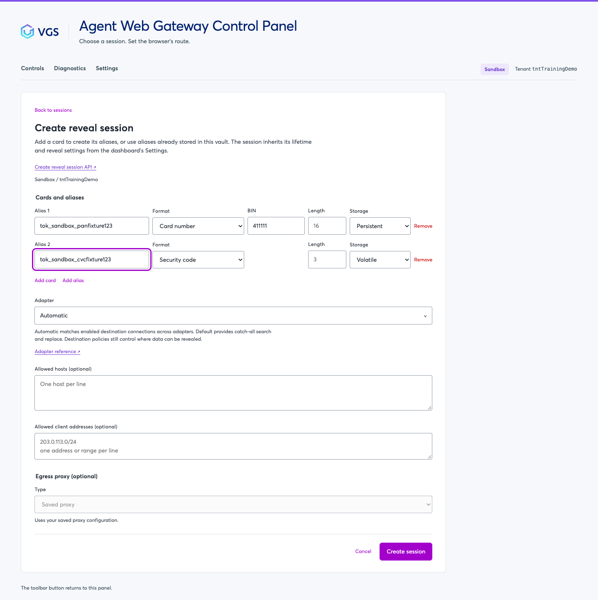
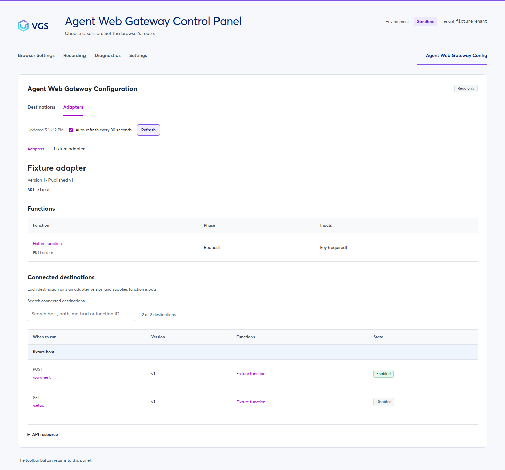

# The control panel in detail

`./awg start` does all of this for you. This page explains what it sets up, and how to run each part by hand.

**Recommended browser workflow:** browse through **Egress Proxy** first. When
checkout is ready, add the card aliases, create a fresh reveal session with the
same egress settings, select it, and enable VGS before loading the payment flow.
Read [Browser proxying best practices](../tools/vgs-proxy-controls/BROWSER-PROXY-BEST-PRACTICES.md)
for the steps, PAC choice, cleanup and the current launcher's initial-session requirement.

The current **Agent Web Gateway Control Panel** source and local helper are in
[`tools/vgs-proxy-controls/`](../tools/vgs-proxy-controls/). For a CLI-first lab, page 10 includes
[launch examples for Chrome for Testing, Chromium, Chrome, Edge and Brave](training/10-proxy-controls-extension.md#browser-launch-examples).

**Download a build:** open **Actions → Build control panel**, select a successful
run for the branch you want, then download **agent-web-gateway-control-panel** from
its **Artifacts** section. It contains the versioned source/helper ZIP and its
checksum. Artifacts are kept for 30 days and require repository access and a
GitHub sign-in. During draft review, choose the PR branch; after merge, use `main`.
See [download and build instructions](training/extension-distribution.md#download-or-build-the-kit)
for the CLI equivalent and local builds.

The download contains source, not a configured extension. Run its helper with
your own credentials and an active saved session, then load the generated
`.private-extension` directory. The [distribution guide](training/extension-distribution.md)
also covers a future store release and simpler first-run onboarding.

Use the same browser and configuration when reproducing an existing result.
The alternative launch examples do not make those browsers equivalent to
CloakBrowser or provide anonymity.

## Launch it from the command line

Requires Python 3.10+, Chrome for Testing, your service-account credentials and an
**active session's original creation response**. The launcher needs that initial
session; after setup, the panel can create additional sessions. Set up the VGS CA
through your approved browser process before using the VGS routes.

From a checkout, copy the tool to a new working folder. In Terminal 1:

```bash
cp -R tools/vgs-proxy-controls "$HOME/vgs-proxy-controls"
cd "$HOME/vgs-proxy-controls"

# Replace these with your own private files, kept outside the repository.
AWG_ACCOUNT_FILE="/absolute/path/to/service-account-credentials.yaml"
AWG_SESSION_FILE="/absolute/path/to/sessions/RS_EXAMPLE.json"
AWG_SESSION_DIR="/absolute/path/to/sessions"

python3 start-proxy-controls.py \
  --environment sandbox \
  --credentials-file "$AWG_ACCOUNT_FILE" \
  --session "$AWG_SESSION_FILE" \
  --sessions-dir "$AWG_SESSION_DIR"
```

Keep the helper running. For an artifact download, use its extracted folder instead
of the copy step. In Terminal 2 on macOS, with Chrome for Testing in `/Applications`:

```bash
AWG_EXTENSION_DIR="$HOME/vgs-proxy-controls/.private-extension"
"/Applications/Google Chrome for Testing.app/Contents/MacOS/Google Chrome for Testing" \
  --user-data-dir="$HOME/Library/Application Support/AWG Testing/chrome-for-testing" \
  --load-extension="$AWG_EXTENSION_DIR" \
  --no-first-run
```

Use a new dedicated profile. The control-panel tab opens automatically. Regular
Chrome, Edge and Brave use a one-time **Load unpacked** step; see the
[browser-specific commands](training/10-proxy-controls-extension.md#browser-launch-examples).

## What you should see

These screenshots use synthetic Sandbox data and local fixtures. They show the
interface, not a real account, merchant transaction or completed tokenization.

**1. Browser Settings:** confirm the tenant, configure egress, and choose **Egress Proxy**
before browsing. Create the payment reveal session when checkout is ready.
Choose **No Proxy** to turn proxying off for this browser profile.



**2. Settings:** check the environment and connected account. Use **Browse…** to
select a dashboard or CLI credentials export. The service-account section includes
copyable CLI setup instructions.



**3. New session:** at checkout preparation, open **New session…**, add a card
through Collect or use available aliases, and create a session with the same
egress used for browsing. Select the new session, then explicitly enable a VGS
route before loading checkout. Selection preserves the current route.



**4. Diagnostics:** inspect the actual PAC script and the HAR export setting.
Enabling sensitive-HAR export does not start a recording. The optional MCP setup
appears under **Connect an assistant with MCP**.


**5. Agent Web Gateway Config:** inspect destinations and adapters. Open an adapter
to see its functions and connected destinations, including the inputs supplied by
each destination. This panel is read-only.



Use the separate **Recording** tab to start and stop a selected tab's HAR capture.

When finished, select **No Proxy**, close the test browser and stop the helper with
Ctrl-C. Keep credentials, generated extensions, saved sessions and HAR files private.

## Use with a coding assistant

Give your assistant this repository and the following setup request:

> Help me install the Agent Web Gateway Control Panel using the repository's
> browser walkthrough. Check my Python and browser versions, use my local Sandbox
> credentials and original saved session response, and create a dedicated browser
> profile. Keep credential contents out of chat and source control. Start the helper,
> launch the browser, and help me verify the tenant, selected session, and proxy route.
> Follow Browser proxying best practices: browse through Egress Proxy, then add the
> card and create a fresh payment reveal session with the same egress near checkout.
> Do not submit a merchant payment.

The assistant needs access to your computer to execute those steps. The repository
and extension alone do not grant it browser control or access to HAR recordings.

## Connect Claude to captures and gateway tools

The optional [MCP companion](../tools/vgs-proxy-controls/MCP.md) connects to the
dedicated browser and the panel's local helper. It can record one selected tab,
read unredacted HAR headers and bodies, and inspect functions, adapters,
destinations and bindings using the account configured in Settings. Gateway
authoring and route-function dry-runs are available with `--mcp-write`.

The [setup guide](../tools/vgs-proxy-controls/MCP.md) includes the helper command,
browser debugging flags, Claude Code registration command and a sample recording
prompt. Start with capture/read access, then enable writes when ready to author
configuration. Service-account credentials stay in the helper; captured traffic
is intentionally available to the connected assistant. Browser captures precede
VGS transformations and need separate gateway or echo evidence to verify reveal.

