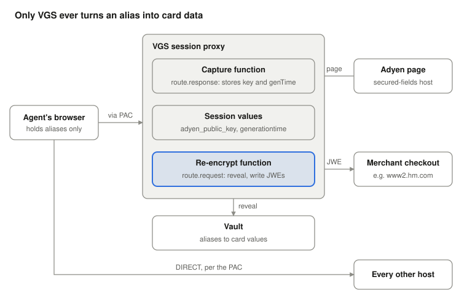

# Agent Web Gateway: Internal Engineering Spec

Nov 12, 2026 · @Mahmoud Abdelkader

## Overview

The Agent Web Gateway (AWG, AR-193) lets an AI agent pay on a merchant's website with a card stored in a VGS vault, while the agent and its browser only ever hold aliases. The agent gets a **reveal session**: a short-lived, per-tenant forward proxy credential plus a PAC file. Traffic to the hosts the session allows passes through the VGS session proxy, where the tenant's **adapter functions** (Larky) run on requests and responses. The functions swap placeholders for real card data in the merchant's own format at the moment the request leaves VGS.

The Adyen client-side-encryption flow is the reference integration:

1. The agent's browser loads the merchant's Adyen secured-fields page through the session proxy. A **capture function** (`route.response`) reads the merchant's RSA public key and Adyen's `genTime` from the page and stores them in the session with `session.put`.
2. The agent types a placeholder card into Adyen's fields; Adyen's iframe encrypts the placeholder.
3. The checkout POST goes through the session proxy. A **re-encrypt function** (`route.request`) reveals the session card's aliases from the vault, encrypts each value as an Adyen JWE (`RSA-OAEP-256` / `A256GCM`, header `version: 1`) under the captured key, and replaces the browser's ciphertext.
4. Only Adyen can decrypt the result. The PAN never reaches the agent, the browser or the merchant's page.




The capture function feeds the re-encrypt function through session values; only the re-encrypt function talks to the vault, and hosts outside the PAC list never touch VGS.

## Concepts and data model

Seven objects make up AWG. A session is short-lived; everything else is configuration that lives in vault-management (Postgres schema `agent_gateway`, cached in Redis for the proxy).

| Object | Id prefix | What it is | Key attributes |
| --- | --- | --- | --- |
| Reveal session | `RS` | One agent task's credential: a proxy login, a PAC file, the cards it may reveal, its context and the values functions store | `adapter`, `allowed_hosts`, `allowed_client_cidrs`, `cards` / `aliases`, `context`, `egress_proxy_settings`, `unlisted_host_mode` (read), `proxy.url` / `proxy.pac_url` / `proxy.ca_bundle` (create only), `state`, `reveal_count`, `refusal_count` |
| Agent destination | `AGD` | A host pattern the tenant's agents may reach, and how VGS treats it; backed by a forward-proxy route | `host_pattern`, `action` (`trust`, `guarded`, `block`), `origin` (`manual`, `auto`), `route_id` |
| Registry destination | UUID | VGS's global trusted-destination list, inherited by every tenant | `host_pattern`, `mode` (`trusted`, `guarded`), `status` |
| Function | `FN` | A Larky program for one extension point; immutable, so a new version is a new function | `name`, `language` (`larky`), `extension_point` (`route.request`, `route.response`, `invoke`), `inputs`, `source`, `sha256`, `owner`, `previous_version` |
| Adapter | `AD` | A named bundle of functions with numbered, immutable versions (one per integration, e.g. `adyen`) | `name`, `functions` (of the version shown), `version`, `latest_version`, `published_version` |
| Adapter destination (binding) | `AX` | Runs a pinned adapter version's functions on matching traffic | `adapter`, `adapter_version`, `enabled`, `when` (`host`, `method`, `path` glob), `functions` (`id` + `inputs`), `revision` |
| Function invocation | `FI` | A recorded run of one function: a dry run of a route function, or an `invoke` function | `function`, `status`, `error`, `duration_ms`, `result` (create response only) |

Rules that hold across them:

- **Cards are aliases.** A session card is `{label, number, cvc, expiry, holder}`, each part an alias with `alias`, `bin`, `length`, `storage` (`PERSISTENT` or `VOLATILE`). Functions reveal them with `vault.reveal`; nothing else in AWG sees the PAN. At most 20 alias parts and 20 hosts per session.
- **Context is set by the session's creator; values are set by functions.** `session.context(key)` reads what the creator passed (at most 32 keys, values up to 512 characters). `session.put` / `session.get` hold what functions learn (e.g. `adyen_public_key`), stored per adapter; `include=values` returns `values["AD…"]["adyen_public_key"]`.
- **A session's `adapter` scopes its bindings.** With no adapter the session matches every enabled adapter destination of the vault.
- **A binding pins one adapter version and runs only functions of that version** (`function_not_in_adapter` otherwise). Bindings of different versions of one adapter can run together in a session. A binding's `when.host` must be one of the vault's agent destinations that is not blocked.
- **Two enabled bindings may not run functions in the same phase on traffic both could match** (`409 destination_overlap`; the check is conservative).
- **Inputs** are named per function and bound per binding: `constant` (`value`), `request.body` / `response.body` (`path`), `request.header` / `response.header` / `request.query` (`name`), or `session.value` (`key`, behind `vgs.agentGateway.sessionValueInputs`). A request function reads only request sources; a response function only response sources.
- **Ownership:** functions and adapters are owned by the tenant (`owner: tenant`) or by VGS (tenant id `vgs`, `owner: vgs`). VGS rows are written only through `/admin`; tenants read VGS functions and published VGS adapters, and may bundle or pin them. The tenant id `vgs` is reserved (`400 reserved_tenant`).
- **Functions and adapters are soft-deleted; destinations are not.** `DELETE` on a function or adapter sets `deleted_at` / `deleted_by` and keeps `status` (ACTIVE/DISABLED); the row is never returned again and its name is free. A function bundled by a live adapter returns `409 function_in_use`; an adapter used by any binding returns `409 adapter_in_use`. Agent destinations, adapter destinations and registry destinations are hard deletes.

## Tenant API reference

34 tenant endpoints (49 with admin) on `https://sandbox.vgsapi.com` / `https://vgsapi.com`, JSON:API, tenant from the `VGS-Tenant` header. Read from vault-management `awg/stack-top` `d37e6452` (cell-21); every scope and error code is cited to file and line in [02-internal-api-detail.md](02-internal-api-detail.md).

Conventions: write scopes do not imply read. Errors are `{"errors":[{status, code, title, detail, href}]}`. `400` validation and `409` conflict carry a `code`; `403` (missing scope) and `404` carry a message only. Tenant AWG endpoints other than sessions refuse the reserved tenant `vgs` with `400 reserved_tenant`.

**Reveal sessions** (`reveal-sessions:read` / `:write`; gate `vgs.revealSessions.enabled`)

| Endpoint | Does | Notable codes |
| --- | --- | --- |
| `POST /reveal-sessions` | Creates a session; `201` with `tokens`, `cards` (with session alias values), `proxy {url, ca_bundle, pac_url}`; the only response with secrets | `missing_aliases`, `too_many_aliases` (20), `invalid_host`, `never_host`, `too_many_hosts` (20), `invalid_context`, `invalid_adapter`, `invalid_client_cidr`, `invalid_egress_proxy_*`, `ttl_not_configurable`, `unlisted_host_mode_not_configurable`, `step_up_not_configurable`, `session_too_large` (stateless) |
| `GET /reveal-sessions` | Pages sessions, newest expiry first; `state=active` (default) or `revoked`; `offset`, `limit` 1..100 | `invalid_state`, `invalid_paging` |
| `GET /reveal-sessions/{id}` | One session without secrets; `include=values` adds function values keyed by adapter | `invalid_include`; `404` also for stateless sessions |
| `DELETE /reveal-sessions/{id}` | Revokes (`204`, idempotent); stateless ids get a revocation marker when the tenant's revocation list is on | `409 revocation_list_disabled` |
| `POST /reveal-sessions/{id}/credentials` | Reissues the proxy password (`200`); off by default (`credentialReissueEnabled`) | `404 credential_reissue_disabled`, `409 session_not_active` |
| `GET /reveal-sessions/proxy-ca` | The forward-proxy CA bundle and host | `404` when no bundle is configured |
| `GET /reveal-sessions/{id}.pac?tenant&expires&signature` | The PAC script; no auth, the HMAC-signed link is the credential | every failure is an empty `404` |

**Step-up approvals** (`reveal-sessions:read` / `:write`)

| Endpoint | Does | Notable codes |
| --- | --- | --- |
| `GET /reveal-session-approvals?filter[reveal_session]=RS…` | Lists a session's held requests | `missing_filter`, `invalid_paging` |
| `GET /reveal-session-approvals/{id}` | One approval (`AP…`): host, method, path, state |  |
| `PATCH /reveal-session-approvals/{id}` | `state` `approved` / `denied`, `scope` `request` (default) or `session` | `invalid_state`, `invalid_scope`, `id_mismatch`, `409 approval_closed` |

**Destinations and registry** (`agent-gateway:read` / `:write`)

| Endpoint | Does | Notable codes |
| --- | --- | --- |
| `GET /agent-gateway-destinations`, `GET …/{id}` | The tenant's destinations (max 1000) |  |
| `POST /agent-gateway-destinations` | `host_pattern` + `action` (`trust`, `guarded`, `block`); creates a forward-proxy route; a `trust` records the approver | `invalid_host_pattern`, `invalid_action`, `never_host`, `too_many_destinations`, `409 destination_exists` |
| `PATCH /agent-gateway-destinations/{id}` | Changes `action` only | `host_pattern_immutable`, `origin_not_writable`, `route_tag_limit` |
| `DELETE /agent-gateway-destinations/{id}` | Hard delete of route and row | no in-use check against bindings |
| `GET /agent-gateway-registry` | VGS's ACTIVE registry entries as `trust` / `guarded` |  |

**Functions and dry runs** (`agent-gateway:read` / `:write`)

| Endpoint | Does | Notable codes |
| --- | --- | --- |
| `GET /functions?filter[name]=` | Own and VGS functions, newest first, max 200 |  |
| `GET /functions/{id}` | One function with source |  |
| `POST /functions` | `name`, `extension_point`, `source` (≤ 256 KiB, must parse, no `${`, `vault` only via `load`), `inputs` (≤ 32), `previous_version` | `invalid_name`, `invalid_extension_point`, `invalid_source`, `source_too_large`, `invalid_inputs`, `invalid_previous_version` |
| `DELETE /functions/{id}` | Soft delete of an own function | `409 function_in_use`; `404` for VGS functions |
| `POST /functions/{id}/invocations` | Dry run (route functions) or run (`invoke`); `201` even on failure | `invalid_invocation`, `invalid_inputs`, `invalid_function`, `503 invocations_unavailable` |
| `GET /function-invocations`, `GET …/{id}` | Run records (max 100), never `result` | `invalid_filter` |

**Adapters and bindings** (`agent-gateway:read` / `:write`)

| Endpoint | Does | Notable codes |
| --- | --- | --- |
| `GET /agent-gateway-adapters`, `GET …/{id}` | Own adapters (latest version) and published VGS adapters (effective version) |  |
| `POST /agent-gateway-adapters` | `name` + 1..32 visible `functions`; version 1 | `invalid_name`, `invalid_functions`, `409 adapter_exists` |
| `POST /agent-gateway-adapters/{id}` | New version (`functions` only), `200` | `name_immutable`, `adapter_not_found`, `409 adapter_version_conflict` |
| `PATCH /agent-gateway-adapters/{id}` | Publishes the latest version: `publish_at` `now` or a future time | `invalid_attributes`, `invalid_publish_at` |
| `DELETE /agent-gateway-adapters/{id}` | Soft delete; frees the name | `409 adapter_in_use` |
| `GET /agent-gateway-adapter-destinations?filter[adapter]=`, `GET …/{id}` | The vault's bindings (max 100) |  |
| `POST /agent-gateway-adapter-destinations` | `adapter` + `adapter_version` (default latest own / effective VGS), `when`, 1..16 `functions` with `inputs`; or one function and no adapter, which creates an `fn-<FN id>` adapter | `unknown_host`, `destination_blocked`, `invalid_when`, `function_not_in_adapter`, `invalid_inputs`, `invalid_adapter_version`, `409 destination_overlap`, `409 adapter_conflict` |
| `PATCH /agent-gateway-adapter-destinations/{id}` | Change `adapter_version`, `enabled`, `when`, `functions`; optimistic on `revision` | `adapter_immutable`, `409 concurrent_change`, `409 destination_overlap` |
| `DELETE /agent-gateway-adapter-destinations/{id}` | Removes its route entries, then the row |  |

Session limits: TTL is not settable per session; it is the tenant's `revealSessionDefaultTtlSeconds` (default 300 s, minimum 30), capped by the platform's `maxSessionLifetimeSeconds` (default 86400). Context: ≤ 32 keys, values ≤ 512 characters, ≤ 4096 characters in total (1024 when stateless). Client ranges: ≤ 10.

## Admin API reference

VGS staff manage what every tenant inherits through 15 tenant-less `/admin` endpoints: the trusted-destination registry, and VGS-owned functions and adapters. They need a client role of Keycloak client `vault-mgmt-http-api` (not a scope; realm roles and other clients' roles do not count) and OPA on; without OPA they answer `503`.

| Resource | Endpoints | Role (read / write) | What it changes |
| --- | --- | --- | --- |
| Registry destinations | `GET`, `GET /{id}`, `POST`, `PATCH /{id}` (`mode`, `status`), `DELETE /{id}` on `/admin/agent-destinations` | `admin/agent-gateway:read` or `admin/agent-destinations:read` / `admin/agent-gateway:write` or `admin/agent-destinations:write` | The global list every tenant inherits as `trust` or `guarded`; `DELETE` is a hard delete, the actor is only logged; `503 agent_destinations_admin_disabled` without OPA or the DB |
| VGS functions | `GET`, `GET /{id}`, `POST`, `DELETE /{id}` on `/admin/functions` | `admin/agent-gateway:read` / `admin/agent-gateway:write` | VGS-owned functions, readable by every vault; `DELETE` is soft and `409 function_in_use` while an adapter of any owner bundles it |
| VGS adapters | `GET`, `GET /{id}`, `POST`, `POST /{id}` (new version), `PATCH /{id}` (publish), `DELETE /{id}` on `/admin/agent-gateway-adapters` | same | VGS adapters; `publish_at: now` makes the latest version visible to every vault, a future time schedules it; `DELETE` is soft and `409 adapter_in_use` while any vault's binding uses it |

Differences from the tenant API: requests act as tenant `vgs` and take no vault; responses show `latest_version`, `scheduled_version`, `scheduled_at` and unpublished versions, which tenants never see; a VGS adapter's functions must themselves be VGS functions. Tenants cannot create, version, publish or delete VGS rows: their `DELETE` gets `404` and their `POST`/`PATCH /agent-gateway-adapters/{id}` gets `400 adapter_not_found`.

## Proxy behavior

The session proxy (`awg-http-proxy`, proxy in `awg` mode) refuses unless every check passes; no failure path reveals. Plaintext, tokens and aliases are never logged or put in events (`RevealSessionStep`).

**Authentication.** The proxy username is the session id (`RS` + 22 base58 characters) and the password is the session's proxy secret, either a JWE (stateless session) or a Redis-held secret. Any failure, including an unavailable store, rejects the credentials; other usernames go to the normal forward-proxy authenticator (`RevealSessionAuthenticator`). A tenant whose `{tenant}.sandbox.verygoodproxy.com` does not resolve to an AWG cell reaches the shared proxy, which answers `407` to session credentials.

**Intercept or tunnel.** A CONNECT is tunnelled only when nothing can be revealed to, decided for or audited on that host: the session is `STRICT` and no session host, tenant TRUST/GUARDED/BLOCK override or ACTIVE registry entry matches. Every doubt intercepts (MITM with the session's CA, returned as `proxy.ca_bundle`) (`SessionInterception`).

**Per request, in this order** (`RevealSessionStep`, `SessionStateCheck`):

1. Client address against the session's allowed client ranges (`allowed_client_cidrs`); an unknown address is refused when ranges are set.
2. Kill switch, then a reload of the session: revoked, expired or store unavailable refuses. The tenant's current TTL preference (`revealSessionDefaultTtlSeconds`) applies on every request, bounded by the operator cap, so lowering it shortens live sessions. A stateless session lives until its expiry or until its revocation key exists.
3. The host decision: never-host list, then the session's `allowed_hosts`, tenant BLOCK override, trusted destination (registry or tenant override), auto-guarded routes, then the fallback by `unlisted_host_mode`.
4. Adapter destinations matching host, method and path run their functions: `route.request` before the request leaves, `route.response` on the way back. A function that calls `fail()` ends the request with `422 Request processing error. Request id: <id>`.

**Unlisted hosts** (`UnlistedMode`, read-only on the session; the request may not set it). vault-management derives it at creation from the tenant's preferences: `agentGatewayAutoGuardedRoutes = true` gives `guarded`; else a step-up webhook URL (`agentGatewayStepUpWebhookUrl`, hold 5 to 30 s, default 20) gives `step_up`; else an explicit `false` gives `strict`; unset gives `guarded`. `STRICT` refuses, `GUARDED` reveals under the reveal guard's caps, `STEP_UP` holds the request for the customer's approval through the webhook and `/reveal-session-approvals`. A held request blocks a processing thread, so concurrent holds are capped and step-up needs the separate client event loop; otherwise it is refused `STEP_UP_UNAVAILABLE`.

**PAC split** (`GET` the session's `proxy.pac_url`, vault-management #823). The PAC sends the session's `allowed_hosts` and the `when.host` of every enabled adapter destination through VGS, in every unlisted-host mode; every other host goes to the session's egress proxy when one is set, else `DIRECT`. It fails closed (everything through VGS) for stateless sessions, lookup failures and unsafe host patterns. Chrome passes only the host to `FindProxyForURL` for HTTPS URLs, so the split cannot select paths.

**Egress.** `egress_proxy_settings` (`type`, `scheme`, `hostname`, `port`, `username`, `password` write-only) chains the session's outbound traffic through the tenant's own proxy (e.g. a residential provider), so the merchant sees one IP for VGS-routed and PAC-direct traffic (`SessionEgressChainedProxy`).

## Function runtime

A function is a Larky module with one entry point, `process(input, ctx)`, that returns the (possibly changed) message. It runs in the proxy on every request or response its binding matches. The reference runtime is Larky 1.1.0 (no load-once: every script is evaluated per use).

```python
load("@vgs//agent_gateway", session="session")   # session API: a module, never a global
load("@vgs//vault", vault="vault")
load("@vendor//jose/jwe", jwe="jwe")
load("@stdlib//json", json="json")
adapter_input = None                               # bound by the runtime to this binding's inputs

def process(input, ctx):
    text = input.body()                            # the message body as a string
    form = adapter_input(input, "adyen_form")      # an input bound on the adapter destination
    key = session.get("adyen_public_key")          # stored earlier by a capture function
    if not key:
        fail("public key unavailable")             # the proxy answers 422, see below
    card = session.card()                          # or session.card(label)
    number, = vault.reveal([card.number])
    ...
    input.set_body(json.dumps(body))
    return input
```

| Call | Returns / does | Notes |
| --- | --- | --- |
| `input.body()` / `input.set_body(s)` | Read / replace the body | Strings; JSON is parsed by the function |
| `adapter_input(input, name)` | The bound value of input `name` | `constant` inputs give the value; `request.body` inputs give the JSONPath selection |
| `session.context(key)` | A value the session's creator passed | Read-only |
| `session.get(key)` / `session.put(key, value)` | Values functions share across requests in one session | Kept per adapter |
| `session.card(label=None)` | The session card: `.number`, `.cvc` (aliases) | `.cvc` is absent when the card has no CVC alias |
| `vault.reveal([aliases])` | Plaintext values, same order | Each reveal is a reveal decision and counts in `reveal_count` |
| `fail(msg)` | Stops the function | The client gets `422 Request processing error. Request id: <id>`; the message does not reach the client |

Behaviours to design for:

- **Returning the input unchanged is silent.** H&M's function only acts on `adyenData.encryptedAdyenForm` with H&M's field names; on a standard Adyen Web body (`paymentMethod.encryptedCardNumber`) it returns the body untouched, with `reveal_count=0` and no error.
- **A missing alias fails the whole request.** H&M's function reveals CVC whenever the form has `encryptedAdyenSecurityCode`; with a CVC-less card, `getattr(card, "cvc", None)` passes `None` to `vault.reveal` and the checkout gets `422`.
- **Where `generationtime` comes from differs by function version.** The v6 re-encrypt functions read `session.context("adyen_generationtime")` (the creator's clock); H&M's v7 function and capture use Adyen's page `genTime` via `session.put`.

**Dry runs** (`POST /functions/{id}/invocations`) run one function in Compute (10 s deadline, bodies up to 1 MiB) on a given `request` (method and absolute URL required) or `response` (a `route.response` function takes a response only), with `inputs` as plain values or a `destination` (AX id) to take that binding's inputs, and an optional `session: {values, context}`. The response is `201` even when the run fails (`status: failed`, `error`); on success `result` carries the rewritten request or response and `result.session.values` after the run. `session.card` and aliases always fail in a dry run, so a re-encrypt function can be dry-run only up to its reveal. Input and output are not stored.

## Auth, scopes and OPA

Every AWG call passes two independent checks, the JWT scope check in the controller and OPA per path and method, so a new path needs both or it answers `403`.

| Layer | Rule | Where |
| --- | --- | --- |
| Scopes (tenant) | `reveal-sessions:read` / `reveal-sessions:write` for sessions and approvals; `agent-gateway:read` / `agent-gateway:write` for destinations, registry, functions, invocations, adapters and bindings. Write does not imply read. | `helpers/SecurityRoles.java`, `agentgateway/AgentGatewayScopes.java` |
| Roles (admin) | Client roles of `vault-mgmt-http-api`: `admin/agent-gateway:*`, `admin/agent-destinations:*` | `AgentGatewayScopes.java:44-69` |
| OPA | `opa/policies/http/reveal_sessions.rego`, `agent_gateway.rego` (vault resource permission `read` / `write`), `admin_access.rego:62-89`; only `GET /reveal-sessions/*.pac` is excluded | vault-management `opa/`, `application.yaml:343-370` |
| Gateway route | Each public path needs a route on the VGS API gateway (vgs-charts `gateway-routes`) and the matching OPA bundle in vgs-charts | vgs-charts |
| Feature gates | `vgs.revealSessions.enabled`, `vgs.agentGateway.enabled` (paths unmapped, `404`, when off); reveal sessions need OPA or `vgs.revealSessions.allowWithoutOpa` | `application.yaml:261-266` |
| Preferences | `agentGateway*` preference writes need `agent-gateway:write` as well as the preferences scope | vault-preferences |


## Observability and debugging

A failed function reaches the client as `422 Request processing error. Request id: <id>`, with no stage, function or reason; everything else has to be looked up by that request id.

| Source | What it shows | How | Who can use it |
| --- | --- | --- | --- |
| Request id | Correlates everything below | `vgs-request-id` response header; in the 422 body | Anyone with the response |
| Access log | The request as VGS saw it | audits API `GET access-logs/{request id}`; CLI `vgs logs access -R <id>` | Credentials with `access-logs:read` |
| Operation logs | Functions and operations run for the request | audits API `GET op-pipeline-logs?filter[tenant_id]=…&filter[trace_id]=<id>`; CLI `vgs logs operations -V <vault> -R <id>` | Same |
| Reveal decisions | Each reveal allowed or refused, and why | audits API `GET access-logs/{id}/reveal-decisions`; CLI `vgs logs reveal-decisions -V <vault> -R <id>` (vgs-cli #350) | Same |
| Session | Counters and what functions stored | `GET /reveal-sessions/{id}?include=values` (values keyed by adapter id), `reveal_count`, `refusal_count` | Tenant API |
| Dry run | A function's error text on a given input | `POST /functions/{id}/invocations` | Tenant API; stops at `session.card` |
| Proxy app logs | Everything, including Larky stack traces | Grafana Cloud (OTLP) for the cell; `kubectl logs -c app` is empty on cells | VGS engineers only |
| awg-harness | Per-field result of a function on a merchant body, decrypted | `awg_harness.py verify merchants/<m>.json [--function FN…=file.star]` | Tenant credentials |

The customer audits API base is `https://audits.apps.verygood.systems`. Not yet checked: whether `op-pipeline-logs` carries the text passed to `fail()`.

**Planned: session request log** (design `session-request-log/2026-11-11-session-request-log-design.md`). The `RevealDecision` audit event becomes the per-request record (new fields `request_id`, method, path, phase, `route_id`, `filter_id`, `adapter_id`, `function_id`, stage, `error_class`, outcomes `FORWARD` and `ERROR`). vault-management's consumer writes the protobuf events to Redis `rs:{tenant}:log:{sid}` (RPUSH, LTRIM 500, EXPIRE 3600), served by `GET /reveal-sessions/{id}?include=requests`; auditit stays the history. The 422 page then names the failed stage. Step 1 (events and error page) is assigned; the vault-management writer and the dashboard panel follow.

## Customer environments

Use Sandbox for integration tests and Live for authorized production activity.
The tenant API bases are `https://sandbox.vgsapi.com` and `https://vgsapi.com`,
respectively. Use the proxy URL, port, PAC URL and CA returned by the session API;
do not construct or substitute those values. Confirm feature availability for
your tenant with VGS before relying on a feature described in this dated reference.

## Known gaps and open work

The biggest gap is that nothing past the gateway has been proven: no Adyen authorization through AWG on a real merchant yet. Each item below names what closes it.

| Gap | Effect | What closes it |
| --- | --- | --- |
| No live-merchant authorization yet | Untested: live Adyen accepting the per-field payload (`{value, generationtime}` only, no Secured Fields telemetry); 3-D Secure; Akamai on the checkout POST | One real checkout with a real card through the PAC, item and total confirmed first |
| Function errors reach the client as a bare `422` | Tenants cannot see which function failed or why | Session request log, step 1 (events and named error page) |
| PAC splits by host only | All of `www2.hm.com` goes through VGS, not just the checkout: H&M pages took 2.40 s and 2.69 s through VGS vs 0.812 s direct (one visible-browser run each) | Route only the checkout POST through VGS (browser-side), after measuring where the extra time goes |
| First page load through VGS met Akamai `403` | Seen in both visible-browser runs that completed; later pages loaded | Measure again with residential egress (`egress_proxy_settings`) |
| H&M's function is H&M-specific | Hardcoded `adyenData.encryptedAdyenForm` and H&M field names; no-op on standard Adyen Web bodies | A general Adyen function with the form path and field names as inputs |
| A CVC field with a CVC-less card fails the request | `422` instead of leaving the field or a clear message | Function checks `card.cvc` before revealing |
| Larky stateful types (hashes, ciphers) are mutable after freeze | Later hardening, not a known exploit | Freeze audit (`larky-stateful-types-freeze-audit`) |
| Reads are not audited; `RevealSessionAudit` to the customer trail and the registry actor are deferred | Audit trail gaps | AWG audit fast-follows |

Tooling for tenants: the awg-harness `verify` command (capture dry run plus decrypted re-encrypt through the real proxy) is built and passes for H&M, JYSK, Dunelm and Alza; `record` (capture a real checkout without placing it) and `live` are not built.
