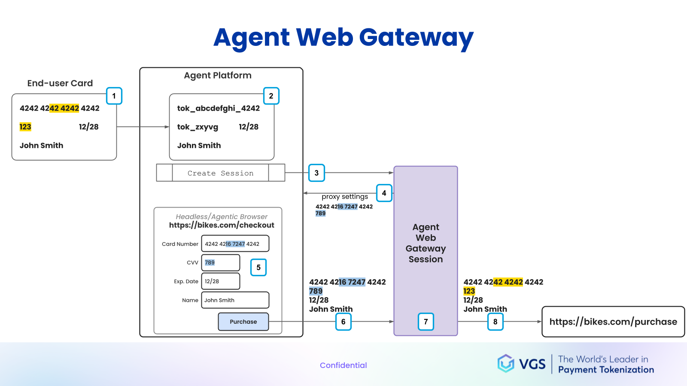
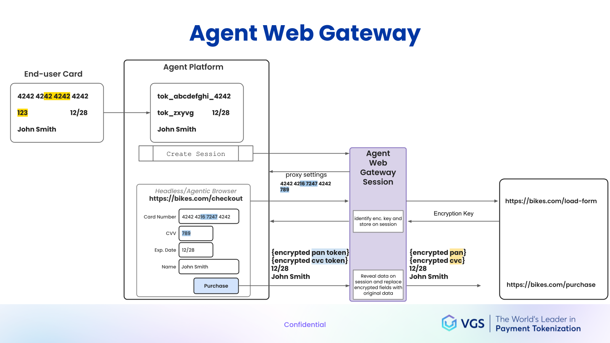

# 1. What AWG is

**When you finish this page you can** explain what AWG does, the two ways it puts the card into a payment, and what it does not do.

## The problem

An AI agent that shops for a person has to type a card number into a merchant's page. If the agent holds the real number, it can leak it or send it anywhere.

AWG lets the agent finish the checkout while holding only stand-in values.

## How it works

1. **The card is already stored in the VGS vault.** Your systems keep only **aliases** for it.
2. **You create a reveal session** when the agent is about to pay. You send VGS the card's aliases and the hosts the agent may pay on.
3. **VGS returns four things:**
   - a proxy URL with the session's login (`proxy.url`);
   - a link to a PAC file (`proxy.pac_url`), which tells a browser which hosts to send through VGS;
   - a CA certificate (`proxy.ca_bundle`), which the browser must trust for those hosts;
   - **session tokens** (`tokens` and `cards`): stand-in card values for the agent to type.
4. **The agent's browser uses the proxy**, and the agent types the session tokens into the payment form.
5. **VGS puts the real card into the payment request** as it passes through, and sends it on to the merchant.

The proxy login, the PAC link and the session tokens are returned only once, in the create response. Save them then.

## Two ways the card gets into the request

Which one applies depends on how the merchant's payment provider takes the card.

### 1. The provider takes plain card fields

VGS finds the session tokens in the request and replaces them with the real values. No adapter is needed: put the provider's API host in the session's `allowed_hosts`.

### 2. The provider encrypts the card in the browser

The browser encrypts whatever the agent typed, so there is no plain token left to swap. An **adapter** with two **functions** handles this:

1. A **capture function** reads the provider's encryption key from the payment page as it loads, and stores it in the session.
2. A **re-encrypt function** runs on the checkout request. It gets the real card from the vault, encrypts it with the stored key, and replaces what the browser sent.

Only the payment provider can decrypt the result. Adyen is the reference integration for this case.

Page 5 covers adapters.

## Where the traffic goes

Only the payment hosts go through VGS. With the session's PAC file, the browser sends the session's `allowed_hosts`, and the hosts its adapters are bound to, through the VGS session proxy. Every other site loads directly, or through your own egress proxy if the session sets one.

VGS terminates TLS for the hosts that go through it. That is why the browser must trust the session's CA, and it is what lets VGS change the request.

## What AWG does and does not do

It does:

- Keep the card number in the vault and, for the moment of the request, inside VGS. The agent and its browser hold session tokens only.
- Refuse unless every check passes. No failure path reveals the card.
- Fail the request if a function cannot run, instead of sending the stand-in or the card anywhere else.
- Refuse certain hosts always, such as public echo and request-bin services (`never_host`).

It does not:

- Get an agent past a merchant's bot protection. A `403` from a merchant comes from that protection. The gateway path can trigger it; page 6 shows how to tell.
- Enforce anything if the browser ignores the PAC file. The browser then connects directly, and nothing is revealed, refused or recorded.
- Handle wallets and redirects such as PayPal, Klarna or Apple Pay.
- Warn you when a function does nothing. A function that does not recognise a request passes it on unchanged, with no error, and the merchant receives the worthless stand-in values. This is the most common failure in testing.

---

## Details

- **Returned once.** An endpoint that reissues the proxy password exists but is off by default. The CA bundle can also be read from `GET /reveal-sessions/proxy-ca`.
- **PAC fallback.** The PAC file sends everything through VGS for stateless sessions, lookup failures and unsafe host patterns.
- **The Adyen flow in full.** The capture function also stores Adyen's `genTime`. Nothing decrypts what the browser produced; it is discarded. A diagram of this flow is [request-path.svg](../reference/request-path.svg).

