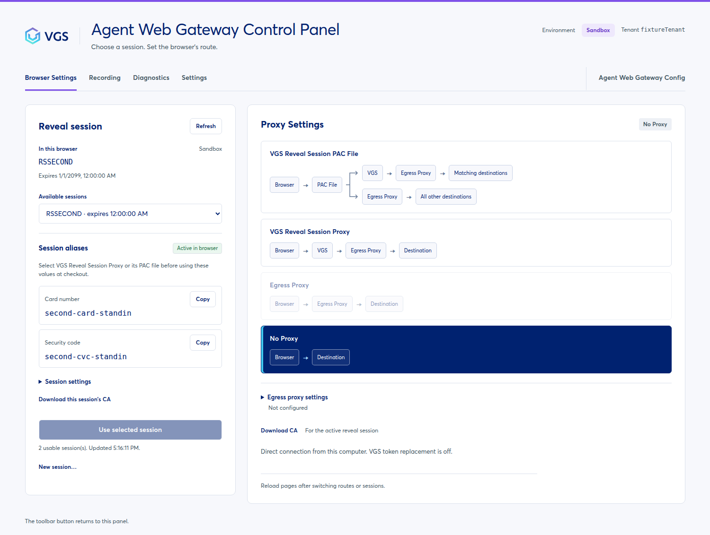
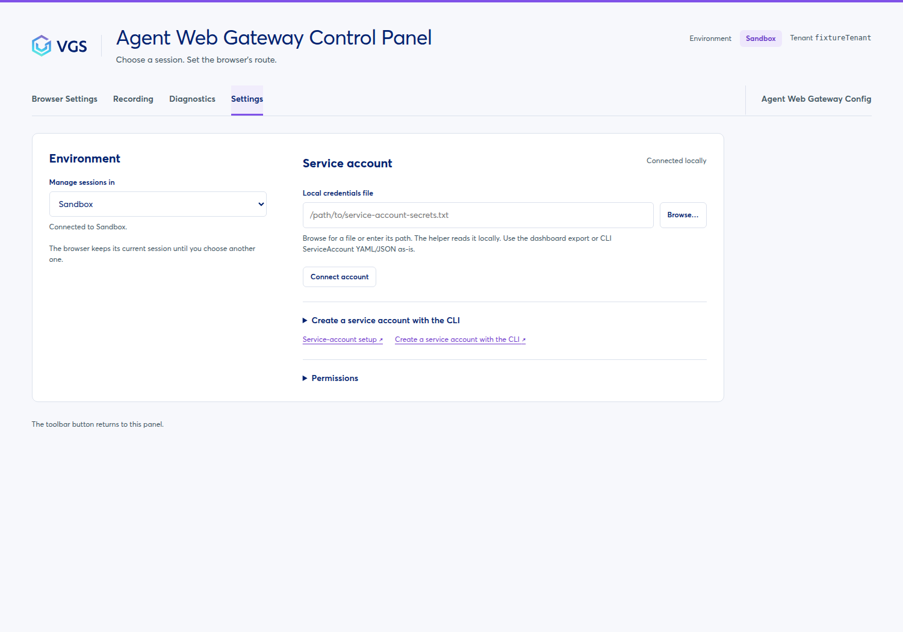
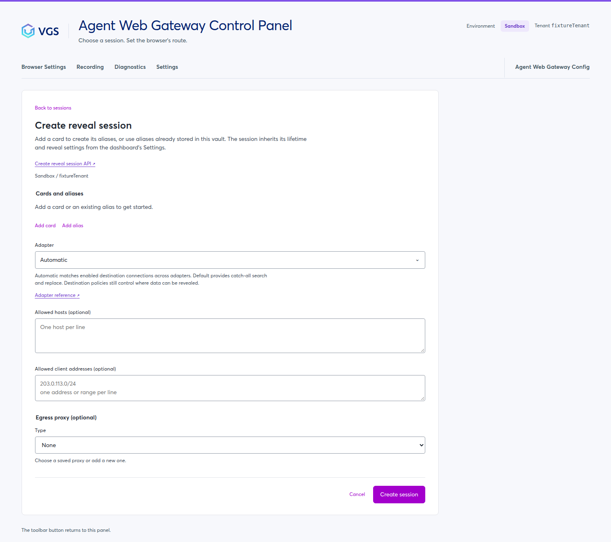
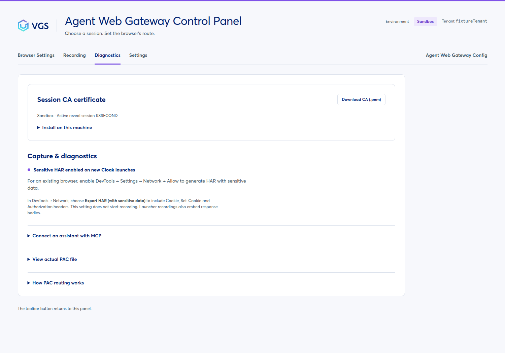
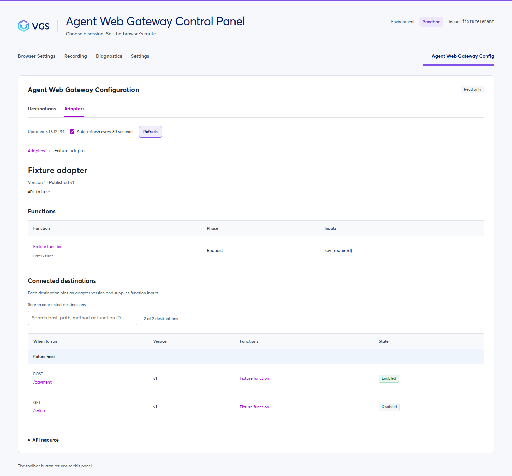

# 10. Agent Web Gateway Control Panel

**When you finish this page you can** load the extension, connect a service account,
create or select reveal sessions, inspect the PAC file and switch browser routes.

The repository includes the full **1.8.0** control-panel source and local helper.

An optional [MCP companion](../../tools/vgs-proxy-controls/MCP.md) lets an assistant
record one selected tab, inspect unredacted HAR data and use the configured
account for gateway authoring. Its guide includes Claude Code setup and browser
debugging commands. MCP is separate from the ordinary extension installation.
The package is built by **Actions → Build control panel**; see
[download and build instructions](extension-distribution.md#download-or-build-the-kit).
The screenshots below use synthetic local fixtures, not a live account.

Use your own Sandbox account for this walkthrough. The panel also offers Live,
with separate credentials; switching the setting does not grant API access.

## What it does

| Route in Proxy Settings | Where traffic goes |
|---|---|
| **PAC File** | Hosts selected by the session's PAC use VGS; other traffic follows the PAC's egress or direct route |
| **VGS Proxy** | Browser traffic uses VGS, then the session's configured egress |
| **Egress Proxy** | Browser traffic uses the session's egress or a manually configured proxy, without VGS replacement |
| **No Proxy** | Direct connection from this computer |

The panel also shows the tenant and session ID, reads the actual PAC, accepts
local service-account exports, and creates sessions using hosted VGS Collect
fields or existing aliases. It does not fill merchant forms or submit payments.

## Recommended browser workflow

Start browsing through **Egress Proxy**. Prepare the basket in the same browser,
then add the card aliases and create a fresh reveal session when checkout is
ready. Give that session the same egress configuration, select it, and switch to
**VGS Proxy** before opening checkout or loading its payment frames. Use **PAC
File** when its actual rules cover the payment hosts you need.

The [browser proxying best-practices guide](../../tools/vgs-proxy-controls/BROWSER-PROXY-BEST-PRACTICES.md)
covers the complete sequence. It also explains two separate settings: a manual
browser egress is not copied into new reveal sessions, and selecting a session
does not enable VGS. The current launcher's initial-session prerequisite below
still applies; first-time setup is not yet session-free.

## What you need

1. Python 3.10 or later and a dedicated Chromium browser profile. Chrome for
   Testing is the recommended introductory setup.
2. Your own Sandbox service-account credentials. Session selection needs
   `reveal-sessions:read`; creation also needs `reveal-sessions:write`.
   Collect tokenization uses `aliases:write`, or `cards:create` for card creation.
   The `agent-web-gateway-admin` template grants `cards:create`, `cards:read`,
   and `cards:update`, plus alias creation and read/write access to reveal
   sessions and gateway settings. It excludes card deletion and PAN/CVC reads;
   it does not require preferences or vault-list permissions.
3. An **active session's original creation response**, saved as `RS….json`.
   The launcher currently needs this before it can generate the extension, even
   though the panel can create later sessions. A GET/list response is insufficient.
4. For authenticated custom egress, the original creation request saved beside it
   as `RS….request.json`, because the response masks its password.
5. Approved CA trust setup for that session before using VGS proxy routes. The
   extension does not install certificates or disable TLS verification.

## Steps

### 1. Get the tool

Download and extract the build artifact, or copy the source from a checkout:

```bash
cp -R tools/vgs-proxy-controls "$HOME/vgs-proxy-controls"
cd "$HOME/vgs-proxy-controls"
python3 --version
```

Choose a new working folder; adapt the paths if that folder already exists.
For an artifact download, place its extracted kit at that same location instead.
If `python3` is older than 3.10, use an installed newer Python executable throughout.

### 2. Prepare your credentials

The launcher accepts a CLI ServiceAccount credentials YAML/JSON with tenant
metadata, or a private environment file. To prepare the latter:

```bash
cp sandbox.env.example "$HOME/vgs-proxy-controls-sandbox.env"
chmod 600 "$HOME/vgs-proxy-controls-sandbox.env"
```

Fill in your tenant ID, client ID and client secret in that private file. Keep
its Sandbox API/authentication settings. Do not put credentials in this repository.
A dashboard export without tenant metadata can be connected in the panel later;
the current launcher needs a file that includes the tenant.

### 3. Check your inputs

```bash
python3 start-proxy-controls.py \
  --environment sandbox \
  --session /absolute/private/sessions/RS_EXAMPLE.json \
  --credentials-file "$HOME/vgs-proxy-controls-sandbox.env" \
  --sessions-dir /absolute/private/sessions \
  --check
```

Use your actual session filename and paths. This check validates local inputs
without contacting VGS. **Success:** it prints that local inputs are valid.

### 4. Start the helper

Run the same command without `--check`, and leave the terminal open. It prints the
private generated extension directory. Start the browser using one of the
[launch examples](#browser-launch-examples) below, or select that directory through
**Extensions → Developer mode → Load unpacked** in a dedicated browser profile.

The control-panel tab opens automatically. Confirm **Settings → Environment →
Sandbox** and your tenant. Changing the environment setting alone keeps the
browser's selected route and session.



### 5. Connect or check your account

In **Settings**, confirm the selected environment and tenant. The launcher's
account is already loaded. To change it, choose **Browse…**, select your local
credentials file, then **Connect account**. File contents stay in the helper;
the tenant comes from file metadata or the authenticated account's token metadata,
without a tenant-list API lookup.

Expand **Create a service account with the CLI** for the login → generate → apply
walkthrough. It requires a CLI build containing `agent-web-gateway-admin`; check
`vgs generate service-account --help` before following it.



### 6. Select or create a session

Before browsing, configure **Proxy Settings → Egress proxy settings**, save, and
select **Egress Proxy**. Defer the fresh payment session until checkout preparation.

Choose an entry under **Available sessions** and click **Use selected session**.
The current route is preserved. Reload merchant pages after switching and use the
new session's values from **Session aliases** in any checkout fields.

For a new session, open **New session…**. Use **Add card** for VGS Collect hosted
fields, or **Add alias** for existing aliases. Sandbox offers public **Test cards**
shortcuts. Creating aliases and then a session are explicit separate actions;
neither submits a merchant payment. Configure the new session with the same
egress used for browsing; manual browser egress settings are not copied into this
form. The new session's private creation response is saved locally. Select it
when ready, then explicitly enable the VGS route before loading checkout.



### 7. Inspect routing and turn it off

Select a route in **Proxy Settings**. **Diagnostics → View actual PAC file → Load
PAC script** shows the script used by the current session. PAC chooses routes by
host, not checkout stage. To proxy only the checkout portion manually, use
**Egress Proxy** while browsing, then select **VGS Reveal Session Proxy** before checkout.



Open **Agent Web Gateway Config** to inspect destinations and adapters. Each
adapter contains its functions and connected destinations. Destination details
show the inputs supplied to those functions; the view does not edit or approve
gateway configuration.



Use the separate **Recording** tab to capture one selected test tab. Recording
does not change the proxy route. See the [recording instructions](../../tools/vgs-proxy-controls/README.md#automatic-test-recording)
for the browser debugging setup and capture controls.

Choose **No Proxy** to turn proxying off. When finished, close the training browser
and press Ctrl-C in the helper terminal. Stopping the helper alone does not turn
off the selected route. End the session through your approved session workflow.

## Browser launch examples

**Recommended for the introductory lab: Chrome for Testing.**
[Chromium](https://www.chromium.org/chromium-projects/) is the open-source browser
project underlying Chrome. [Chrome for Testing](https://developer.chrome.com/docs/automation-and-testing/chrome-for-testing)
is Google's Chrome build for testing, with versioned downloads aligned to Chrome
releases and no automatic browser updates. It can open an ordinary visible window;
it is not an anonymity mode. Pin a maintained build for each cohort and update it
deliberately. Regular Chrome is the everyday, auto-updating product.

Chromium also works as a launch target, but choosing a specific Chrome for Testing
release gives the course a clearer reproducible baseline. Brave remains an
optional privacy-oriented browser compatibility target. For an existing merchant
test, preserve the browser originally used, as explained below.

Run the helper from step 4 first and leave it running. Use a second terminal for
the browser. The examples assume macOS applications installed in `/Applications`;
change the executable path if yours is elsewhere. They launch the browser, but do
not install a browser or configure its CA trust.

Use a separate profile for each browser. Close that training browser before
launching again: an existing process may ignore new command-line flags. Keep the
same profile and generated extension directory for subsequent launches. Proxy
settings affect every tab in that profile.

| Browser | First installation | Later launches |
|---|---|---|
| Chrome for Testing | Load the generated directory with `--load-extension` | Repeat the command with the same profile |
| Chromium | Load the generated directory with `--load-extension` | Repeat the command with the same profile |
| Google Chrome | Developer mode → **Load unpacked** | Launch the same profile |
| Microsoft Edge | Developer mode → **Load unpacked** at `edge://extensions` | Launch the same profile |
| Brave | Developer mode → **Load unpacked** at `brave://extensions` | Launch the same profile |

The packaged local browser harness verifies the four routes, proxy authentication,
session changes and helper UI using synthetic fixtures. Additional browser/version
combinations still need their own smoke test; the launch examples are not a
universal compatibility guarantee.

### Is Brave equivalent to CloakBrowser?

No. Both modify fingerprinting signals.
[Brave's graphics protections](https://brave.com/privacy-updates/38-webgl-webgpu-fingerprinting-protections/)
use generic values, remove identifying details and randomize some signals to
reduce tracking. [CloakBrowser documents](https://github.com/CloakHQ/CloakBrowser)
coordinated, repeatable browser-fingerprint profiles, Playwright/Puppeteer
integration and automation-specific Chromium modifications. Those vendor
capabilities are not effectiveness guarantees verified by this lab.
Installing the same VGS extension does not make
their browser behavior or fingerprints identical, and neither establishes
complete anonymity.

A separate profile isolates local cookies and browsing data. The selected proxy
route determines the network path for traffic it carries. Those are different
from the browser characteristics a website can observe. Even with the same
egress, two browsers can produce different site behavior. Browser protections
may also change which page resources load.

Use the same browser build and configuration to reproduce an existing test. If
that test used CloakBrowser, keep it as the reference environment. Use the examples
here for extension setup and additional browser compatibility checks; they are
not a replacement for that environment. Record the browser/version alongside the
session and route when comparing results.

### What about Kitesurf?

[Kitesurf](https://developers.cloudflare.com/browser-run/kitesurf/) is a different,
experimental engine running on Cloudflare Workers. Cloudflare explicitly leaves
out extensions and lists long-running authenticated sessions with persistent
state as a current limitation. Its Chrome DevTools Protocol support does not make
it a Chromium extension host. It cannot run this control-panel extension; treat a
future AWG integration as separate work, not another launch option in this lab.

### Chrome for Testing: CLI-first path

With the tool copied to the location used in step 1:

```bash
AWG_EXTENSION_DIR="$HOME/vgs-proxy-controls/.private-extension"
"/Applications/Google Chrome for Testing.app/Contents/MacOS/Google Chrome for Testing" \
  --user-data-dir="$HOME/Library/Application Support/AWG Training/chrome-for-testing" \
  --load-extension="$AWG_EXTENSION_DIR" \
  --no-first-run
```

The **Agent Web Gateway Control Panel** tab opens automatically. Its toolbar
button returns to that tab.

### Chromium

```bash
AWG_EXTENSION_DIR="$HOME/vgs-proxy-controls/.private-extension"
"/Applications/Chromium.app/Contents/MacOS/Chromium" \
  --user-data-dir="$HOME/Library/Application Support/AWG Training/chromium" \
  --load-extension="$AWG_EXTENSION_DIR" \
  --no-first-run
```

### Google Chrome, Edge and Brave

Run **one** command for your chosen browser. In the extensions page it opens,
enable Developer mode, choose **Load unpacked**, and select
`~/vgs-proxy-controls/.private-extension`. On macOS, **Cmd+Shift+G** in the folder
chooser lets you enter the hidden folder's full path. Keep the folder in place.

```bash
"/Applications/Google Chrome.app/Contents/MacOS/Google Chrome" \
  --user-data-dir="$HOME/Library/Application Support/AWG Training/chrome" \
  --no-first-run "chrome://extensions"
```

```bash
"/Applications/Microsoft Edge.app/Contents/MacOS/Microsoft Edge" \
  --user-data-dir="$HOME/Library/Application Support/AWG Training/edge" \
  --no-first-run "edge://extensions"
```

```bash
"/Applications/Brave Browser.app/Contents/MacOS/Brave Browser" \
  --user-data-dir="$HOME/Library/Application Support/AWG Training/brave" \
  --no-first-run "brave://extensions"
```

Regular Google Chrome removed `--load-extension` in version 137. Chromium and
Chrome for Testing retain it, according to the
[Chrome team's announcement](https://groups.google.com/a/chromium.org/g/chromium-extensions/c/1-g8EFx2BBY/m/S0ET5wPjCAAJ).
Do not assume every Chromium-derived browser accepts the same extension-loading
flags. The Edge example follows Microsoft's
[documented sideloading path](https://learn.microsoft.com/en-us/microsoft-edge/extensions/getting-started/extension-sideloading).
Managed browser policy may disable developer-mode installation.

### Linux and Windows

For Chromium or Chrome for Testing on Linux, use the executable you installed:

```bash
AWG_BROWSER_BIN="/absolute/path/to/browser-executable"
AWG_EXTENSION_DIR="$HOME/vgs-proxy-controls/.private-extension"
"$AWG_BROWSER_BIN" \
  --user-data-dir="$HOME/.local/share/awg-training/chromium" \
  --load-extension="$AWG_EXTENSION_DIR" \
  --no-first-run
```

For Chrome for Testing on Windows, after preparing the helper and extension with
your own Windows paths, the corresponding PowerShell launch is:

```powershell
$AwgBrowser = 'C:\path\to\chrome-win64\chrome.exe'
$AwgExtension = Join-Path $HOME 'vgs-proxy-controls\.private-extension'
$AwgProfile = Join-Path $env:LOCALAPPDATA 'AWG Training\chrome-for-testing'
& $AwgBrowser "--user-data-dir=$AwgProfile" "--load-extension=$AwgExtension" --no-first-run
```

Use the extension-management UI for regular Chrome on these platforms too.
The macOS/Linux copy and permission commands earlier in this page are not a
Windows setup walkthrough. Windows launch syntax is provided as a sample and
has not been executed here.

### Check the installation and restart it

1. The extension-management page shows **Agent Web Gateway Control Panel** enabled.
2. The panel shows the intended session. **Refresh** works while the helper runs.
3. Choose **No Proxy** to confirm the off control is available. Before selecting a
   VGS route, configure the dedicated browser to trust the session's CA through
   the approved setup from your team. A fresh profile does not establish trust.
4. For the route check, follow [lab 4's verification steps](04-lab-browser-checkout.md#5-check-it-worked)
   on an authorized test destination. An installed extension alone does not prove
   traffic passed through VGS.

After restarting the helper, click **Reload** on the extension-management page
before using it. Its local connection details change on restart. This step is
needed even when the browser profile and generated extension path stayed the same.

## If something goes wrong

| What you see | What to do |
|---|---|
| Launcher refuses to start | Check Python version, an active original session response, tenant metadata in the credentials file and matching environment |
| No usable sessions | Create a fresh session and retain the original response; list/read responses do not include one-time proxy credentials |
| Missing saved egress credentials | Put the matching `RS….request.json` beside the response |
| Could not refresh after helper restart | Keep the helper running and reload the extension from the extensions-management page |
| Different session CA | Use a browser configured for that CA |
| Collect fields fail to load | Check the selected route/session and inspect diagnostics; an expired mandatory PAC can block requests |

## Keep these private

Keep credentials, session/egress files, generated `.private-extension` directories,
browser profiles and HAR recordings private. The generated worker holds proxy
credentials and a signed PAC URL. Share the source/helper artifact, not a packed
copy of your installed extension. Each recipient generates their own private copy.

The helper binds only to loopback, requires a random access token, rejects website
origins and exposes specific account, session, PAC and card-authorization operations.
It is not a general-purpose API proxy. See the
[tool README](../../tools/vgs-proxy-controls/README.md) for environment profiles,
HAR export behavior, manual egress settings and the supported credentials formats.

## Details and sources

The bundled source was imported from the clean 1.7.6 package and updated to 1.8.0
for this repository, including corrected CLI permission text, a tenant placeholder
in the example configuration, screenshots and documentation. Source checksums
are included. The helper and worker have offline tests; the browser harness uses
local fixtures, mocked Collect and no real VGS account or merchant traffic.
Screenshots illustrate the UI, not a completed payment or live tokenization.

Sources: the [tool source and README](../../tools/vgs-proxy-controls/README.md),
[package workflow](../../.github/workflows/control-panel-package.yml), and the
browser vendor documentation linked above. All screenshots are generated from
`test_session_proxy_browser.py` using synthetic account/session data.
