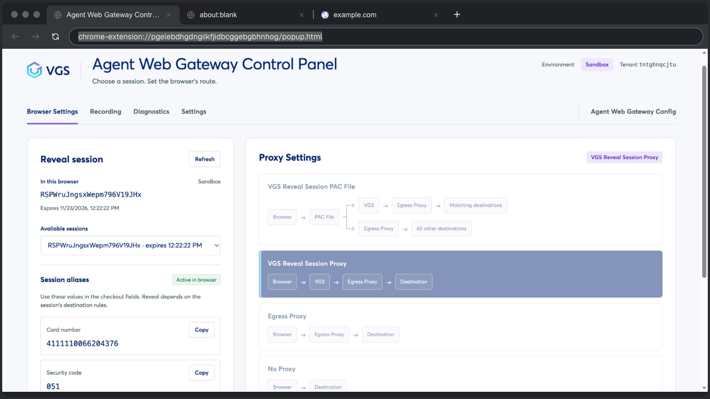
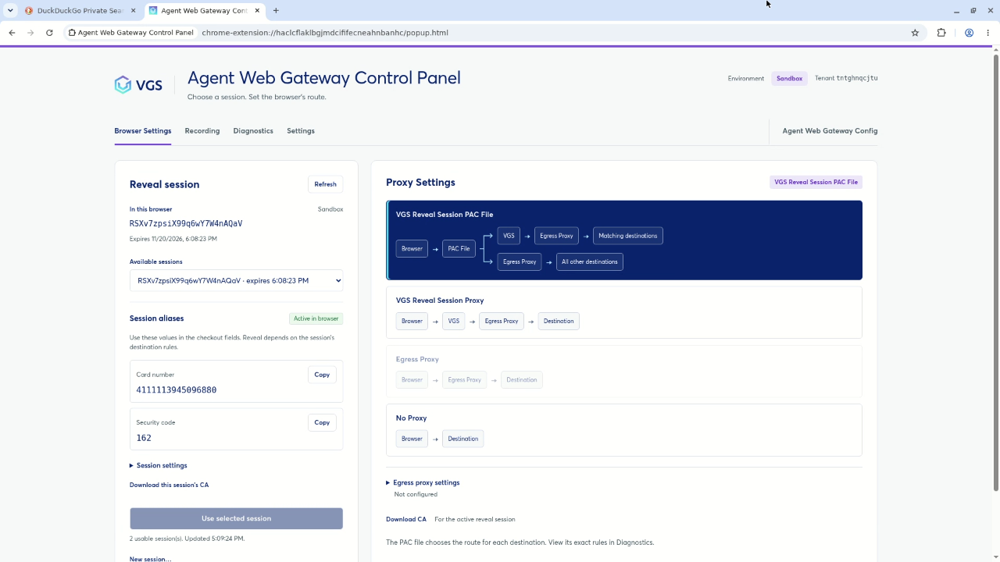
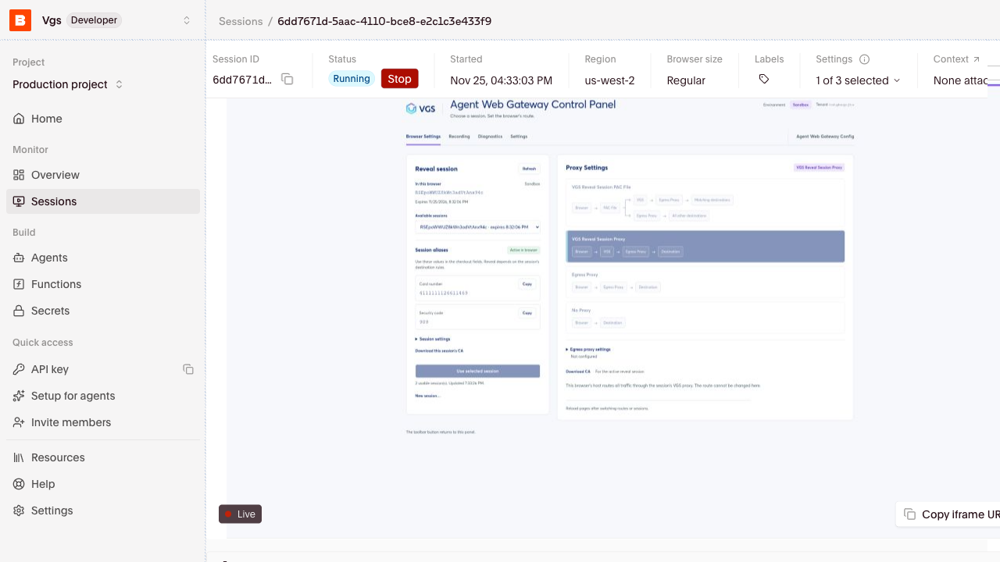

# Examples

How to run the kit with each browser, the agents and payment flow to start from, and the provider adapter examples. Set the kit up first with `./awg setup`; the [README](../README.md) covers that and the concepts.

| Area | What is there |
|---|---|
| [Browsers](#browsers) | One command each for Browser Use, Browser Use Cloud, Kernel and Browserbase |
| [Agents and payment flows](#agents-and-payment-flows) | Scripts that fill a payment form with a session's stand-ins |
| [Provider adapters](#provider-adapters) | Adyen, CyberSource, Stripe and OPPWA functions, bindings, tests and fixtures |
| [Client-side encryption](#client-side-encryption) | What the Adyen and CyberSource adapters do, step by step |

## Browsers

`./awg start` opens CloakBrowser on your machine with the Control Panel. Run one of these instead when your agent runs elsewhere. Each takes the same optional website address.

| Your agent runs on | Command | You need | Guide |
|---|---|---|---|
| [Browser Use](https://github.com/browser-use/browser-use), on your machine | `./awg browser-use` | The same as `./awg start` | [Browser Use](../docs/browser-use.md) |
| [Browser Use Cloud](https://cloud.browser-use.com) | `./awg browser-use --cloud` | A Browser Use Cloud API key for a project with custom proxies enabled; the first run asks for it | [Browser Use](../docs/browser-use.md#use-a-browser-use-cloud-browser) |
| [Kernel](https://kernel.sh) | `./awg kernel` | A Kernel API key on a Start-Up or Enterprise plan; the first run asks for it | [Kernel](../docs/kernel.md) |
| [Browserbase](https://www.browserbase.com) | `./awg browserbase` | A Browserbase API key on the Developer plan or higher; the first run asks for it | [Browserbase](../docs/browserbase.md) |

`./awg browser-use` opens the kit's own browser with a Chrome DevTools address on `127.0.0.1:9222` for your agent.

The other three run the browser in the provider's cloud, so no local browser and no Docker are needed. Each creates or reuses an active test-card session, starts a cloud browser with the session as its proxy and the Control Panel open in a tab, and prints a live view link for watching and driving it.

**Browser Use Cloud**

**Kernel**

**Browserbase**

Each cloud command asks for the provider's API key on its first run and saves it in `~/.vgs/awg/sandbox`, readable only by you. Replace a saved key with `./awg kernel-login`, `./awg browser-use-login` or `./awg browserbase-login`.

A cloud browser stays on the session it started with. To send that session out through an egress proxy you saved in the Control Panel, start the browser with its name: `AWG_EGRESS="My proxy" ./awg browserbase`. The [Browserbase guide](../docs/browserbase.md#egress-proxy) explains it; it works the same for the other commands.

The Control Panel's helper stays on your machine, so your service-account credentials are not uploaded. The session's proxy credentials and the browser's traffic do go to the provider; the card does not. Each guide says what has been verified with that provider.

## Agents and payment flows

Each of these types the session's stand-ins, never a card, and submits nothing unless you ask it to.

| Example | Where the browser runs | What it does |
|---|---|---|
| [`browser-use/checkout_agent.py`](browser-use/README.md) | The kit's browser on your machine, or a Browser Use cloud browser | A Browser Use agent on your machine fills the payment form and stops before submitting |
| [`browser-use/cloud_run.py`](browser-use/README.md) | Browser Use Cloud | A hosted agent run with the session as its custom proxy and the stand-ins as secret bindings |
| [`browserbase/payment_flow.py`](browserbase/README.md) | Browserbase | A Playwright script opens a vendor's payment page, fills it, and submits only with `--submit` |

Each folder's README has the commands and says what has been run against the provider.

## Provider adapters

Each example includes its own functions, a small binding specification, tests, and synthetic HAR fixtures:

| Provider | Example | What it demonstrates |
|---|---|---|
| [Adyen](adapters/adyen/README.md) | Secured Fields and checkout encryption | Capture the key, generation time, and encryption format; re-encrypt the mapped card fields |
| [CyberSource](adapters/cybersource/README.md) | Flex Microform | Capture the context, bridge the pinned SDK for session aliases, and encrypt the Flex token payload |
| [Stripe](adapters/stripe/README.md) | Payment Intent confirmation | Reveal submitted form fields while preserving encoding and unrelated values |
| [OPPWA](adapters/oppwa/README.md) | Checkout form pattern | Handle separate PAN and CVV submissions without requiring a full card object |

These are starting points for authoring, not a catalog of supported destinations. The fixtures are generated from synthetic values and public test cards. No original private HARs are included.

[`adapters/README.md`](adapters/README.md) explains the files in each example and how to run their tests.

## Client-side encryption

Some providers encrypt the card fields in the browser before sending them. The browser then encrypts the session aliases, so the Default adapter can no longer replace those values directly. An adapter coordinates VGS Compute functions across the key-capture and payment requests.

In the **[Adyen example](adapters/adyen/README.md)**, a response function captures the public key, server generation time, and encryption format from secured-fields HTML. The session retains those values. When the checkout submits its mapped card fields, the request function reveals the permitted PAN/CVC inside VGS, encrypts them with the captured key, and replaces the corresponding ciphertext. Browser expiry ciphertext stays unchanged unless an explicit override is configured.

The **[CyberSource example](adapters/cybersource/README.md)** captures the Flex context from the checkout page. Because Flex encrypts the whole card object, a tightly scoped SDK-response function relays only the exact session aliases through TLS to VGS. The request function checks that relay against the captured context, reveals the submitted roles, and creates the JWE expected by Flex. The SDK is version-pinned, the transformed response is not cached, and other card values keep the provider's original browser-encryption path.

The examples include local tests that execute the function source and independently decrypt encrypted output with owned test keys. Native-runtime results and supplemental JVM crypto results are reported separately. Local tests do not establish gateway dispatch or merchant acceptance; follow the [gateway verification guide](../skills/vgs-checkout-adapter/references/gateway-verification.md) before enabling an integration.
