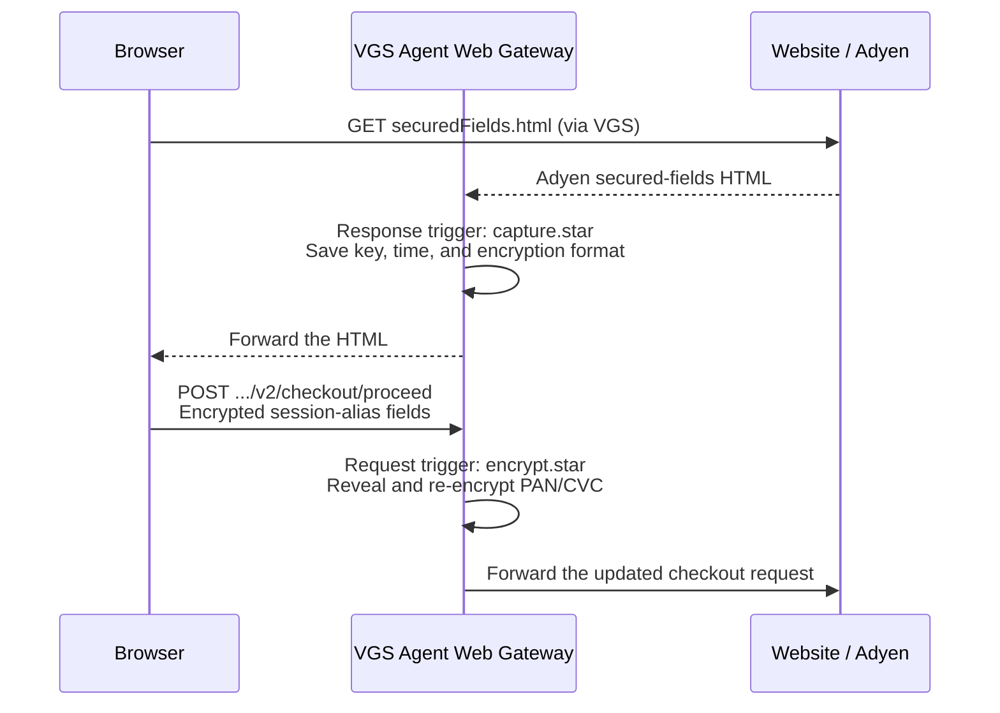

# Adyen: Secured Fields and checkout encryption

This example has one capture destination and one payment destination. [adapter.json](adapter.json) binds the provider-named functions to those two routes:

| Phase | Example route | Function |
|---|---|---|
| Response | GET `checkoutshopper-live.adyen.com/checkoutshopper/securedfields/*/*/securedFields*html` | [Capture key, generation time, and encryption format](functions/capture.star) |
| Request | POST `www2.hm.com/*/v2/checkout/proceed` | [Encrypt mapped card fields](functions/encrypt.star) |

## When the functions run

The self-arrows mark binding matches: that is when VGS runs the function. These flows apply after the example bindings are enabled. Request labels are shortened; the table above has the exact host, method, and path matches.

The capture function reads the provider's key and server time from secured-fields HTML. It also identifies the encryption format wired into the provider script without executing that script. It saves all three values in the reveal session. A page without usable markers leaves the session unchanged; an identifiable key without a usable encryption format fails explicitly.

The request function uses the binding's selectors to find `adyenData.encryptedAdyenForm` in the checkout payload. It reveals only the submitted PAN/CVC roles, encrypts them with the captured key, and writes the ciphertext back. Browser expiry ciphertext stays unchanged unless the session explicitly supplies an expiry override. Unrelated fields and wrappers are preserved.

## Fixtures and tests

Each function has its own synthetic HAR. Requests and responses in these files are authored test data.

| Function | HAR fixture |
|---|---|
| [capture.star](functions/capture.star) | [capture.synthetic.har](fixtures/capture.synthetic.har) |
| [encrypt.star](functions/encrypt.star) | [encrypt.synthetic.har](fixtures/encrypt.synthetic.har) |

[tests.mjs](tests.mjs) loads these files and exercises the corresponding functions, including the failure and pass-through cases below.

[tests.mjs](tests.mjs) covers capture, non-card traffic, missing key/format, partial PAN/CVC requests, and independent decryption of RSA-OAEP-256/A256GCM output. Other formats and SDK versions need their own fixtures and verification.

Follow the [shared test instructions](../README.md#run-the-tests), [Adapters API](https://docs.verygoodsecurity.com/agentic-commerce/developer-resources/api-reference/agent-web-gateway/adapters), and [Functions API](https://docs.verygoodsecurity.com/agentic-commerce/developer-resources/api-reference/agent-web-gateway/functions). This is an authoring example; it does not claim a successful payment.
