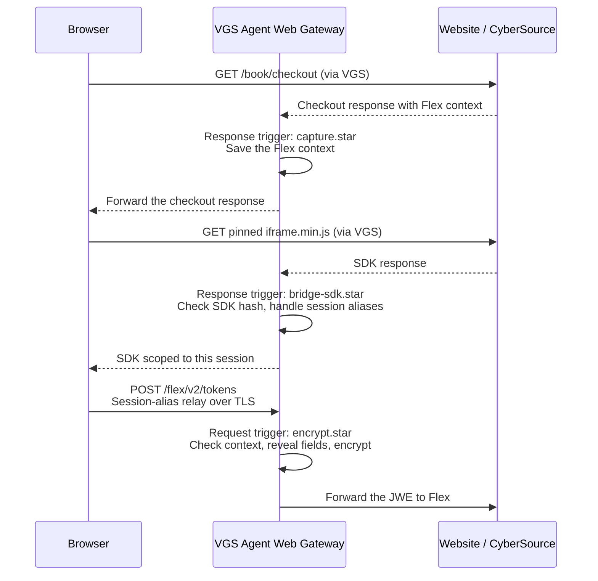

# CyberSource: Flex Microform

This example covers Flex Microform 2.12.1. It has two destination hosts and three bindings in [adapter.json](adapter.json):

| Phase | Example route | Function |
|---|---|---|
| Response | GET `www.alaskaair.com/book/checkout` | [Capture the Flex context](functions/capture.star) |
| Response | GET `flex.cybersource.com/microform/bundle/v2.12.1/iframe.min.js` | [Bridge the pinned SDK for session aliases](functions/bridge-sdk.star) |
| Request | POST `flex.cybersource.com/flex/v2/tokens` | [Encrypt the token payload](functions/encrypt.star) |

## When the functions run

The self-arrows mark binding matches: that is when VGS runs the function. These flows apply after the example bindings are enabled. Request labels are shortened; the table above has the exact host, method, and path matches.

Flex encrypts the complete card object, including expiry. A request function cannot recover that opaque object from its ciphertext. The extra SDK-response binding therefore handles only the exact session aliases: it relays the payload over TLS to VGS, where the request function verifies the captured context, reveals the submitted roles, and creates the provider's JWE. Other card values retain the SDK's original encryption path.

The capture function recognizes the CyberSource payload in HTML, JSON, or a raw context token. The encryption function requires the complete context to match the one captured in the same session; it does not accept a separately supplied browser key. The example uses RSA-OAEP with SHA-1 and A256GCM, as in the observed Microform version. Adyen's RSA-OAEP-256 setting is different.

Before enabling this example:

- Replace `sdk_sha256` with the hash of the exact SDK response you reviewed. A changed hash or unexpected patch anchor stops the transformation.
- Create a fresh session with a unique `cybersource_binding_key` context value, then set that same `session_binding_key` and the returned PAN/CVC session aliases on the SDK and token bindings. The current approach is for one isolated test session at a time; do not share these bindings across concurrent sessions.
- Confirm the tenant processes the required `application/javascript` and `application/jwt` response/request content types. Local tests cannot establish this. Review any required preference changes separately.

The bridge response is marked `no-store, private` because it includes session-specific aliases. The original provider SDK is not redistributed. The [SDK fixture](fixtures/bridge-sdk.synthetic.har) includes a tiny authored SDK double with the relevant patch anchor. It illustrates the flow and tests our bridge, not the actual vendor SDK.

## If the adapter does not run

The token function acts only on the relay payload that the bridged SDK sends. If the browser runs the provider's original SDK, the SDK encrypts the session aliases itself, the token function passes that request through unchanged, and Flex still answers `201`. The signs are:

- The body of `POST /flex/v2/tokens` starts with `eyJ` instead of `AWGCS1:`.
- The card's last four digits in the returned token are the session alias's, the same digits that were typed into the form.

The usual cause is that the browser loaded `iframe.min.js` from its cache, so the request never went through VGS and the SDK-response function could not run. This happens when the checkout was first opened on another route, such as No Proxy or Egress Proxy, and then reloaded on the VGS route. In the browser's Network panel the script shows "(disk cache)" in place of a size. Tick **Disable cache** there, stay on the VGS route, and reload before entering the session aliases.

Two other causes give the same signs: the page loads a Microform version other than the bound path, or the tenant does not process `application/javascript` responses.

To confirm from a HAR without submitting a payment, run the skill's [CyberSource stage report](../../../skills/vgs-checkout-adapter/references/debug-adapters.md#cybersource-flex-stage-evidence). It reports whether the SDK came from cache, whether it carries the bridge, and which of the two shapes the token request has.

## Fixtures and tests

Each function has its own synthetic HAR. Requests and responses in these files are authored test data.

| Function | HAR fixture |
|---|---|
| [capture.star](functions/capture.star) | [capture.synthetic.har](fixtures/capture.synthetic.har) |
| [bridge-sdk.star](functions/bridge-sdk.star) | [bridge-sdk.synthetic.har](fixtures/bridge-sdk.synthetic.har) |
| [encrypt.star](functions/encrypt.star) | [encrypt.synthetic.har](fixtures/encrypt.synthetic.har) |

[tests.mjs](tests.mjs) loads these files and exercises the corresponding functions, including the failure and pass-through cases below.

The tests cover capture, ambiguity, SDK pinning, cache headers, alias/context guards, partial inputs, and independent decryption. Follow the [shared test instructions](../README.md#run-the-tests), [Adapters API](https://docs.verygoodsecurity.com/agentic-commerce/developer-resources/api-reference/agent-web-gateway/adapters), and [Functions API](https://docs.verygoodsecurity.com/agentic-commerce/developer-resources/api-reference/agent-web-gateway/functions). No booking or payment acceptance is claimed.
