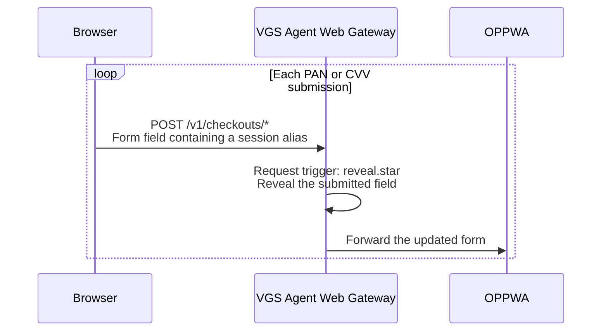

# OPPWA: Checkout form pattern

The [example binding](adapter.json) covers one destination: POST `eu-prod.oppwa.com/v1/checkouts/*`.

## When the functions run

The self-arrows mark binding matches: that is when VGS runs the function. These flows apply after the example bindings are enabled. The destination host and path are specified above.

A binding match runs the function; it does not necessarily reveal data. Expiry-only requests and excluded nested paths pass through without a card reveal.

The [request function](functions/reveal.star) handles `card.number` and `card.cvv` independently. The observed form sends PAN and CVV in separate requests, followed by expiry and cardholder values. Requiring a complete card object would break that pattern.

It reveals the exact submitted nonempty session aliases and preserves unrelated form pairs and browser expiry. The broad path glob also matches nested paths, so the function explicitly passes `/bins`, `/logs`, `/payment`, and other nested paths through without reveals. Default replacement may suffice for intact aliases; this custom example shows precise field and path handling.

## Fixtures and tests

Each function has its own synthetic HAR. Requests and responses in these files are authored test data.

| Function | HAR fixture |
|---|---|
| [reveal.star](functions/reveal.star) | [reveal.synthetic.har](fixtures/reveal.synthetic.har) |

[tests.mjs](tests.mjs) loads these files and exercises the corresponding functions, including the failure and pass-through cases below.

The reveal fixture has three requests: PAN, CVV, and expiry/cardholder. All response bodies are synthetic placeholders, not evidence of merchant acceptance. [tests.mjs](tests.mjs) covers those requests, nested-path pass-through, encoded keys, unrelated fields, blanks, and vault failure.

See [test instructions](../README.md#run-the-tests), the [Adapters API](https://docs.verygoodsecurity.com/agentic-commerce/developer-resources/api-reference/agent-web-gateway/adapters), and the [Functions API](https://docs.verygoodsecurity.com/agentic-commerce/developer-resources/api-reference/agent-web-gateway/functions).
