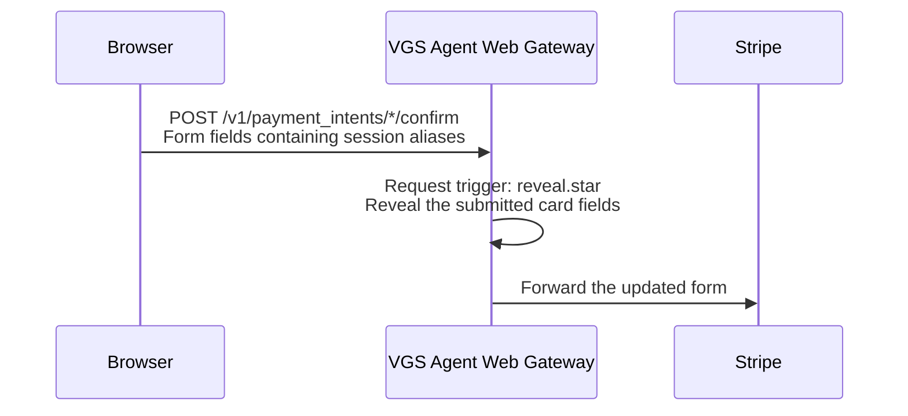

# Stripe: Payment Intent confirmation

The [example binding](adapter.json) covers only POST `api.stripe.com/v1/payment_intents/*/confirm`. It does not include a list of every Stripe endpoint.

## When the functions run

The self-arrows mark binding matches: that is when VGS runs the function. These flows apply after the example bindings are enabled. The destination host and path are specified above.

Stripe submits form-encoded card fields over HTTPS in this pattern. The Default adapter may be sufficient when session aliases appear intact. This optional [request function](functions/reveal.star) demonstrates explicit field-level handling, including PAN aliases formatted with spaces.

It reveals the nonempty values submitted in `card[...]` or `payment_method_data[card][...]`. Each submitted field determines its own reveal; the function does not select a replacement card. It preserves unrelated encoded pairs, repeated fields, and browser expiry. Optional string context values `stripe_expiry_month` and `stripe_expiry_year` explicitly override expiry.

## Fixtures and tests

Each function has its own synthetic HAR. Requests and responses in these files are authored test data.

| Function | HAR fixture |
|---|---|
| [reveal.star](functions/reveal.star) | [reveal.synthetic.har](fixtures/reveal.synthetic.har) |

[tests.mjs](tests.mjs) loads these files and exercises the corresponding functions, including the failure and pass-through cases below.

The reveal fixture contains one Payment Intent confirmation shape. [tests.mjs](tests.mjs) checks formatted PANs, partial CVC, repeated fields, blank and non-card requests, encoding preservation, and vault failure. The fixture contains no Stripe key, client secret, customer ID, or real payment result.

See [test instructions](../README.md#run-the-tests), the [Adapters API](https://docs.verygoodsecurity.com/agentic-commerce/developer-resources/api-reference/agent-web-gateway/adapters), and the [Functions API](https://docs.verygoodsecurity.com/agentic-commerce/developer-resources/api-reference/agent-web-gateway/functions). Authentication and payment acceptance remain separate from a successful transformation.
