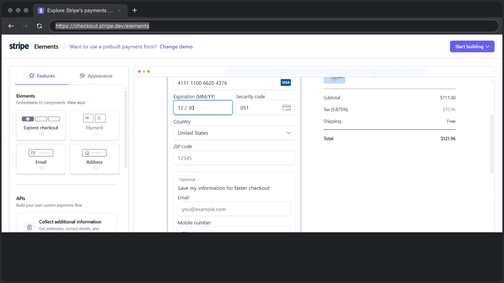

# Browser Use examples

Two ways to run a [Browser Use](https://github.com/browser-use/browser-use) agent through a reveal session. Both type the session's stand-ins, never a card, and stop before submitting the order. [docs/browser-use.md](../../docs/browser-use.md) explains the commands behind them.

| Example | Where the browser runs | Where the agent runs |
|---|---|---|
| [`checkout_agent.py`](checkout_agent.py) | The kit's browser on your machine, or a Browser Use cloud browser | Your machine |
| [`cloud_run.py`](cloud_run.py) | Browser Use Cloud | Browser Use Cloud |

## Your own agent, the kit's browser

```sh
./awg browser-use https://<the site to test>/
```

In another terminal:

```sh
uv run --with 'browser-use==1.0.8rc1' examples/browser-use/checkout_agent.py https://<the site to test>/
```

To run the same agent against a Browser Use cloud browser, start it with `./awg browser-use --cloud https://<the site to test>/` and set `AWG_CDP_URL` to the Chrome DevTools address it prints.

## A hosted run in Browser Use Cloud

```sh
./awg session <the site's host>
BROWSER_USE_API_KEY=… uv run --with browser-use-sdk examples/browser-use/cloud_run.py https://<the site to test>/ <payment provider host>
```

The run uses the session as its custom proxy, which Browser Use enables per project on request. The stand-ins are passed as secret bindings. Browser Use types a secret only into a frame on a listed host, so name the payment provider's host after the URL.

## Status

`cloud_run.py` has been run against Stripe's Elements demo (`https://stripe.dev/elements-examples/` with `js.stripe.com` as the payment provider host). The hosted agent reached the page through VGS, typed the session's stand-ins into the payment form, and stopped before submitting. It has not been run through a submitted order.

[](../../docs/images/browser-use-hosted-run.png)

`checkout_agent.py` has not yet been run end to end. The commands it builds on have: `./awg browser-use` and `./awg browser-use --cloud` both open a browser on a session with the Control Panel working.

Use Sandbox and the public test card only. With Browser Use Cloud, the session's proxy details and stand-ins go to Browser Use.
